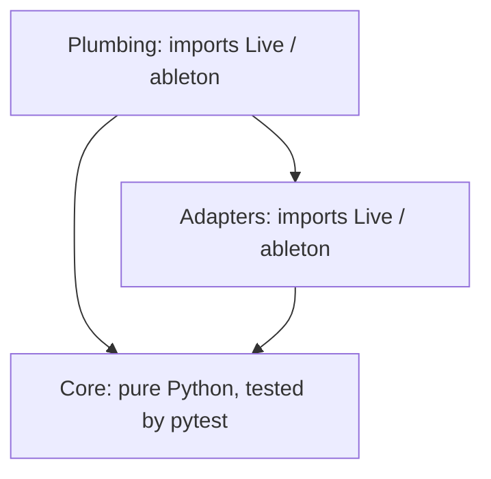
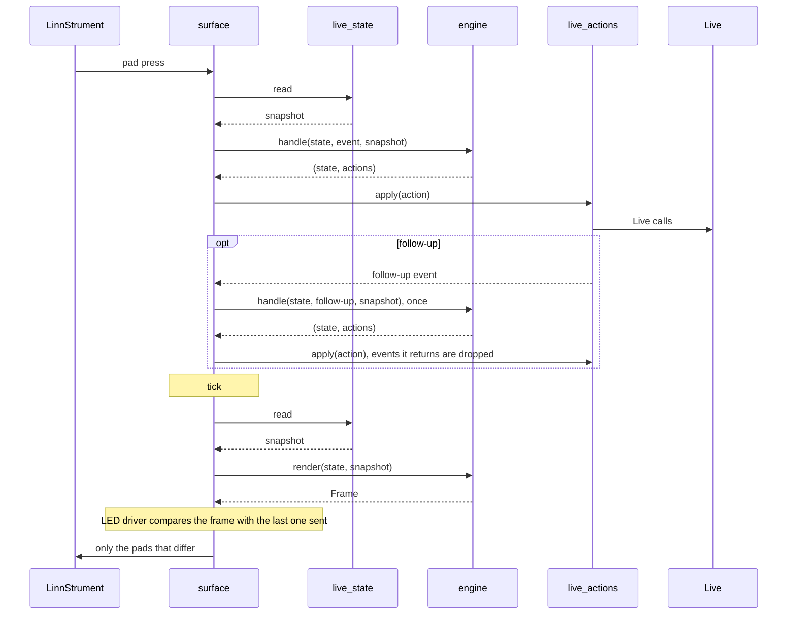
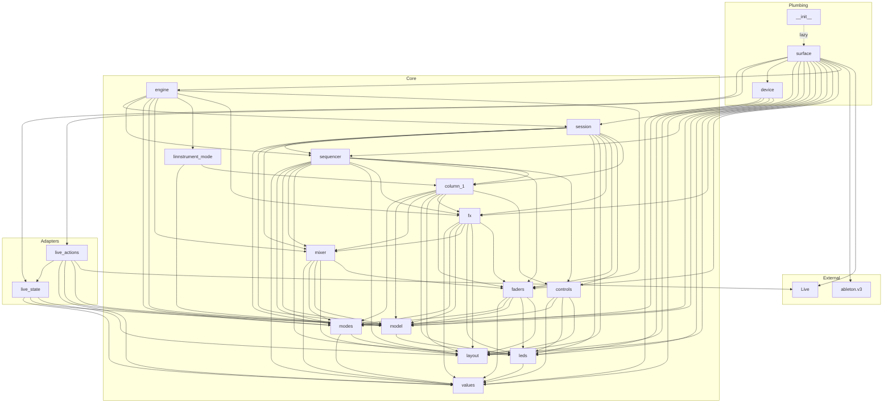
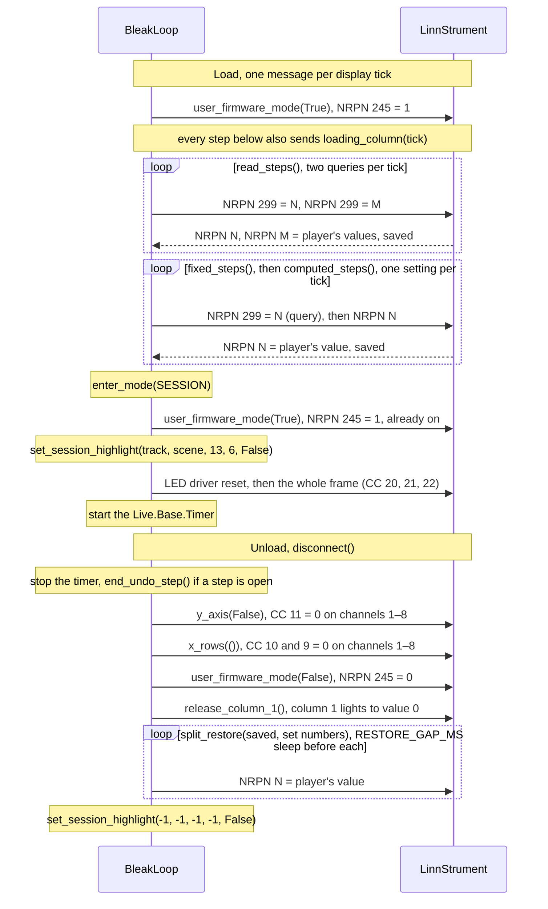
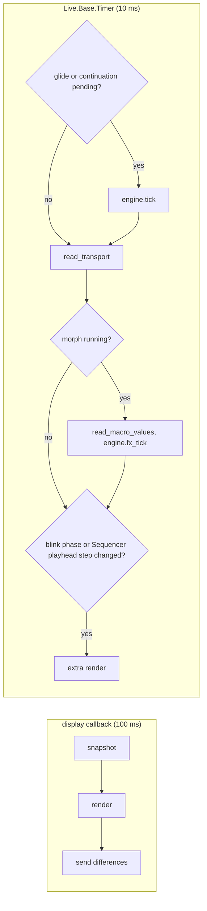
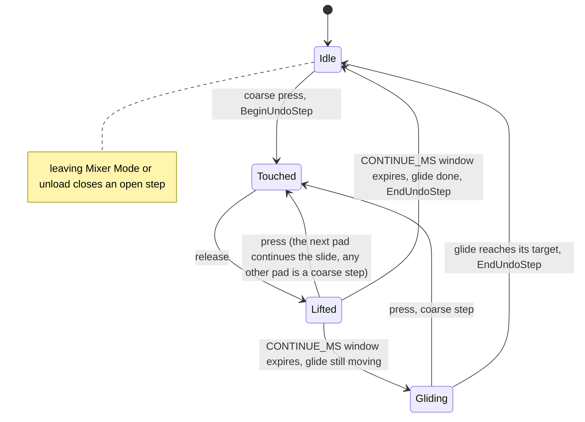
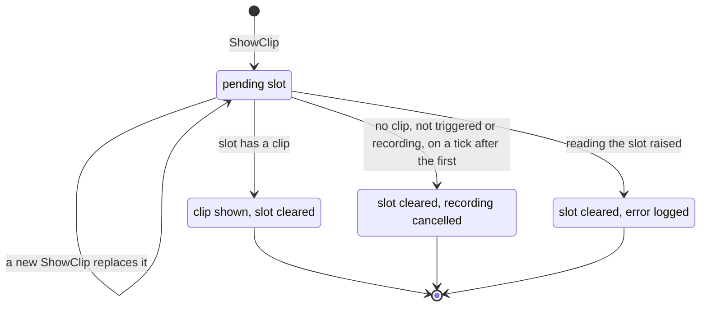

# BleakLoop architecture

How BleakLoop works today. This is a living document: any change to the structure, a device or Live mechanism, or a tuned value updates it in the same PR as the code.

## At a glance


**Where to look:**

| To change… | Look in |
| --- | --- |
| `create_instance` | `__init__.py` |
| Plumbing: `ControlSurface` subclass, elements, MIDI routing per mode, tick | `surface.py` |
| NRPN, split setup and LED message building, LED driver, X and slide decoding | `device.py` |
| Reading Live into a `Snapshot` | `live_state.py` |
| Carrying out an `Action` as Live calls | `live_actions.py` |
| Geometry: pad <-> device row, column roles, 13 x 6 window (8 wide in the split view), window movement and clamping | `core/layout.py` |
| Snapshot, Action and Frame types (plain dataclasses) | `core/model.py` |
| Session / Mixer / Linnstrument / Sequencer, Linnstrument Mode pages, modifiers | `core/modes.py` |
| Shared Session and Linnstrument Mode behaviour: undo, metronome, Play/Stop, record, Fixed Length, tempo steps and scene lights | `core/controls.py` |
| Clip slots, copy and delete rules, mute and select rows, columns 15, 16, Shift layer table | `core/session.py` |
| Column 1 in every mode: its controls, Shift, and Linnstrument Mode's scene page | `core/column_1.py` |
| Mixer toggle, coarse steps, bands, smoothing | `core/mixer.py` |
| FX Mode: snapshot storage format, rack identity, store, recall, morph timing and tick, scene snapshots and their launch and reordering, FX lights | `core/fx.py` |
| Horizontal faders: X maths, touches and slides, undo, fader lights | `core/faders.py` |
| Linnstrument Mode: column 1 only, handed to `column_1` | `core/linnstrument_mode.py` |
| Sequencer Mode: entry, the arm, step maths, editing, pages and loop, note pads, its lights | `core/sequencer.py` |
| Device colours, track colour matching, tempo and fast blink | `core/leds.py` |
| Tuned numbers: every value in section 8, by name | `core/values.py` |
| `handle()` and `render()`, composing the core modules | `core/engine.py` |
| The generated manual pad maps and architecture figures | `tools/docs/` |

Read sections 2–4 for structure, 5–7 for device and Live details, and 8 for numbers.

## 1. Constraints

- Runs on Python 3.11, Live's embedded runtime. The folder `src/BleakLoop/` is the control-surface name and is never renamed.
- Built on an `ableton.v3` `ControlSurface`. `ableton.v3` is undocumented and ships only as `.pyc`, so BleakLoop uses as little of it as possible and only its widely used parts.

## 2. Layers

BleakLoop has three layers. Each may only import from the layers below it.



| Layer | Contents | Imports Live or `ableton`? | Tested by |
| --- | --- | --- | --- |
| Plumbing | `ControlSurface` subclass, MIDI elements, MIDI map and pass-through, session ring highlight, timer tick | Yes | Live restart and Log.txt |
| Adapters | Read Live state into plain snapshots; carry out core actions on Live objects | Yes (thin, no decisions) | Live restart |
| Core | All behaviour: modes, modifiers, Shift layer, grid, copy rules, mixer maths, colours, blinking | **No.** Pure Python | pytest, outside Live |

The plumbing uses v3's elements, MIDI map handling and lifecycle. v3's behaviour components (Session, Mixer, Transport, Clipboard, Modes and its modifier handling) are **not** used: their defaults differ from BleakLoop's copy, delete, arm and Shift behaviour, and they can't be tested outside Live. With v3's background layer excluded and no listeners attached, v3 elements pass the player's MIDI (notes, MPE, Y, pressure) through to tracks untouched. LED output doesn't use v3 elements: the LED driver sends raw MIDI through the control surface.

## 3. The core

The core is a state machine plus a renderer, with no side effects of its own.

- **Input:** `handle(state, event, snapshot) -> (state, actions)`.
  - `event` is a pad press or release, or a tick. A Y-axis value takes its own entry, `y_axis(state, event) -> state`, and so does an X value, `x_axis(state, event) -> (state, actions, redraw)`. A slide transfer goes to `slide(state, event, snapshot) -> (state, actions)`.
  - `snapshot` is a plain, read-only view of the Live state the decision needs.
  - `actions` are plain values such as `FireSlot(track, scene, legato, record_length)`, `Undo()`, `SetVolume(track, value)` or `ShowMessage(text)`. The adapters carry them out.
- **Output:** `render(state, snapshot) -> Frame`. A frame is the colour of every pad the current mode owns: the 8 × 16 surface in Session and Mixer Mode, column 1 in Linnstrument Mode. A pad may blink; the LED driver resolves blinking pads with a `clock` that gives the tempo-blink and fast-blink phase.
- **Sending:** the LED driver compares each frame with the last frame sent and sends only the pads that differ, all in one pass, so blinking pads switch together. Clearing the remembered frame on a mode switch makes every pad correct after the switch.
- **Shift layer:** while Shift is held, `handle` looks up the Shift table and `render` draws the Shift layer. There's no per-element modifier wiring. Shift is column 1's pad 8 in every mode. Entering Session Mode keeps it held. Entering Linnstrument Mode clears it, because the firmware sends the release of a pad pressed in User Firmware Mode as a User Firmware note, which never reaches the control channel.



Snapshots are read fresh on each tick and each event, except Mixer Mode Y reports (section 6, Fader glide) and X reports (section 6, Faders). Polling is chosen for simplicity: 78 clip slots with several properties each, plus 13 tracks, 6 scenes and transport state, a few times a second. A full snapshot costs about 0.5 ms (3 ms at worst).

## 4. Module layout

The core starts coarse and a module is split when it grows.

```
src/BleakLoop/
  __init__.py          create_instance
  surface.py           plumbing: ControlSurface subclass, elements, MIDI routing per mode, tick
  device.py            pure: NRPN, split setup and LED message building, LED driver, X and slide decoding
  live_state.py        adapter: Live -> Snapshot
  live_actions.py      adapter: Action -> Live calls
  core/
    layout.py          geometry: pad <-> device row, column roles, 13 x 6 window (8 wide in the split view), window movement and clamping
    model.py           Snapshot, Action and Frame types (plain dataclasses)
    modes.py           Session / Mixer / Linnstrument / Sequencer, Linnstrument Mode pages, modifiers
    controls.py        shared Session and Linnstrument Mode behaviour: undo, metronome, Play/Stop, record, Fixed Length, tempo steps and scene lights
    session.py         clip slots, copy and delete rules, mute and select rows, columns 15, 16, Shift layer table
    column_1.py        column 1 in every mode: its controls, Shift, and Linnstrument Mode's scene page
    mixer.py           Mixer toggle, coarse steps, bands, smoothing
    fx.py              FX Mode: snapshot storage, rack identity, store, recall, morph timing and tick, scene snapshots, FX lights
    faders.py          horizontal faders: X maths, touches and slides, undo, fader lights
    linnstrument_mode.py  Linnstrument Mode: column 1 only, handed to column_1
    sequencer.py       Sequencer Mode: entry, the arm, step maths, editing, pages and loop, note pads, its lights
    leds.py            device colours, track colour matching, tempo and fast blink
    values.py          every value in section 8, by name
    engine.py          handle() and render(), composing the modules above
tests/                 pytest: the core, the docs generators and the layering
  test_manual.py       every lit pad in the manual's example Sets is labelled; generated docs are current
  test_architecture.py core imports only core; adapters import no plumbing
tools/
  docs/                generated docs (standard library only)
    __main__.py        writes every generated file below; --check
    markers.py         rewrites generated text between marker comments
    svg.py             shared SVG palette and drawing primitives
    manual/            the player's manual
      scenes.py        one example Set per manual layer
      pads.py          pad labels and callout items, by manual section; each map joins its sections
      draw.py          one SVG pad map per layer: labels over the example lights
      generate.py      docs/manual/*.svg and the callout lists in docs/manual.md
    architecture/      this document
      imports.py       the module import graph, from the real imports
      figures.py       the section 5 orientation and colour figures
      generate.py      docs/architecture/*.svg and the import graph in docs/architecture.md
```

The manual's pad maps and callout lists are generated from `core/layout.py` and `render()`, and this document's import graph and section 5 figures from the code. `PYTHONPATH=src python3 -m tools.docs` writes them all, and CI and the pre-commit hook fail when the committed output is stale.

`__init__.py` imports nothing from `ableton` or `Live` at module level; `create_instance` imports `surface` inside the function. This keeps `BleakLoop.core` importable by pytest outside Live. Tests run on Python 3.11 (`uvx --python 3.11 pytest`) to match Live's runtime.

The import graph below is generated from the real imports, and `tests/test_architecture.py` fails if `core/` imports anything outside `core/`.

<!-- generated:imports -->

<!-- /generated:imports -->

## 5. Device interface

Sources (Roger Linn Design): [User Firmware Mode](https://github.com/rogerlinndesign/linnstrument-firmware/blob/master/user_firmware_mode.md), [MIDI input and colour values](https://github.com/rogerlinndesign/linnstrument-firmware/blob/master/midi.md), [Panel settings: CC Faders](https://www.rogerlinndesign.com/support/linnstrument-support-panel-settings), [Tips & tricks: one-column CC Faders split](https://www.rogerlinndesign.com/support/support-linnstrument-linnstrument-tips-tricks).

**Orientation.** Columns are counted from the player's left: column 0 is the device's own control switches, columns 1–16 the playing surface. Pads within a column run 1 (farthest row) to 8 (nearest). The device counts rows the other way, so device row = 8 − pad.


**Messages:**

- **User Firmware Mode:** NRPN 245 = 1 takes over the pads; 245 = 0 hands them back. Accepted on any channel. Every NRPN is CC 99 / 98 / 6 / 38 followed by the CC 101 / 100 = 127 reset. The device confirms each change as NRPN 245 on channel 9 about 20 ms later; BleakLoop doesn't listen for it.
- **Pad input** (User Firmware Mode): Note On for a press, Note Off (or Note On velocity 0) for a release. The channel is the device row (channel 1 = device row 0, the nearest) and the note number is the column. Column 0 reports like any pad and is ignored.
- **Lights:** CC 20 (column, from 0), CC 21 (device row, from 0), CC 22 (colour value).
- **Y-axis:** CC 11 = 1 on channels 1–8 turns reporting on per row, CC 11 = 0 off. Reports arrive as CC (64 + column) on the row's channel.
- **X-axis:** CC 10 = 1 on a row's channel turns X on for that row. X is 14-bit, sent LSB first on CC 32 + column, then MSB on CC column, on the row's channel. The value is global across the surface, about 0–2730: column c's reference X is `X_COLUMN_WIDTH × (c − 1)` (`FXD_CALX_FULL_UNIT` = 4095 / 24 in `ls_calibration.ino`), so its centre is `X_COLUMN_WIDTH × (c − 0.5)`. Row 0's column 6 uses CC 6 and 38 on channel 1, the NRPN reply CCs: those elements carry its X while X is listened, with no duplicate elements.
- **Slide mode:** CC 9 = 1 on a row's channel turns on slide transfers. A finger crossing into the next cell sends CC 119 (value = source column) on the row's channel, then a Note On for the target cell with the first cell's velocity, then a Note Off for the source cell with velocity = the target column. With slide mode off, a crossing is a release and a fresh press with a gap between (below).
- **Clean slate:** each time User Firmware Mode turns on, the device turns X, Y, Z and slide mode off, so they're re-sent after every NRPN 245 = 1. Source: `ls_handleTouches.ino` and [User Firmware Mode](https://github.com/rogerlinndesign/linnstrument-firmware/blob/master/user_firmware_mode.md).
- **Control split** (Linnstrument Mode): set up on load as a one-column note split, column 1 only, in one-channel mode on the control channel (NRPNs in section 8). The setup runs in three phases:
  - **Reads:** Row Offset (227, 253, 263–270) and the right split's channels (100, 101, 102–117, 118), two NRPN 299 queries per step.
  - **Fixed sets:** split on at column 1, one channel, Send X/Y/Z off, no Played colour (a pressed pad would light red over BleakLoop's colour), LowRow off, no special mode, Transpose at 0.
  - **Computed sets:** the control channel and the Octave, worked out from the reads.

  Each set is preceded by a query in the same step, and on unload the player's value is written back for every number BleakLoop set. The control channel is the highest one the right split doesn't use (its main channel, plus its per-note channels or its eight per-row channels). The right split is left untouched, unless it uses all 16: then its highest per-note channel other than the main one is turned off, borrowed and restored on unload. If the right split can't be read, channel 16 is used and the controls stay off. The Octave is the one closest to 0 that keeps all eight column-1 notes in 0–127. In Linnstrument Mode, BleakLoop polls Row Offset and the left split's Octave/Transpose every `POLL_MS`, rebuilds the note map and puts its own Octave/Transpose back if the player changed them. A Row Offset change to custom or Guitar needs values the poll didn't read: column-1 presses are dropped (releases still go through) and the poll repeats at once. A Row Offset that repeats a note in column 1 turns the controls off, with a message, until it changes. The same poll reads the right split's MIDI mode, main channel, per-row lowest channel and the control channel's own per-note switch. If the right split now plays on the control channel, the next poll reads all 16 per-note switches and moves the control channel to the highest free one (NRPN 1), with a message. With none free the controls go off, with a message, and the control channel's notes are no longer listened, so they reach Live's tracks; the full poll goes on until a channel frees up. The right split is never changed mid-session. BleakLoop listens for all 128 notes on the control channel; everything else passes through to Live's tracks.

**Colour values** (CC 22): red 1, yellow 2, green 3, cyan 4, blue 5, magenta 6, off 7, white 8, orange 9, lime 10, pink 11. Value 0 ("as set in Note Lights") also shows dark, but means device default and is used only to hand column 1's lights back on unload. On the device, lime looks yellow and green looks lime.


**Device behaviour BleakLoop depends on:**

- **NRPN changes are RAM only.** Flash is written only when the player commits a change on the panel (releasing Per-Split, Octave, Volume, Preset and the like), and each commit saves the whole config as it is in RAM. Checked on the device: an unload that doesn't restore leaves BleakLoop's split until a power cycle (E1). Panel buttons do nothing in User Firmware Mode (E2), but a commit in Linnstrument Mode saves BleakLoop's split to flash (E2′). BleakLoop never makes the device save.
- **NRPN 299 = N reads setting N.** The reply is a normal NRPN (CC 99 / 98 / 6 / 38, then 101 / 100 = 127) on the query's channel minus one, clamped to channel 1. BleakLoop queries on channel 1, so replies arrive there. NRPN 35 doesn't reply when its combination of special modes is unusual; that setting is then not restored.
- **The device applies light changes one at a time.** A full-grid flip leaves Live in under 1 ms but ripples visibly; BleakLoop never adds to it by spreading changes across refreshes.

> [!NOTE]
> **Bursts lose messages.** In a single burst of the split setup the device dropped a block of about 16–19 messages from the middle, so the split setup is paced one step per display tick: two queries, or one query and one NRPN (about 2.8 s at startup). Each step carries one column of the loading rainbow (24 light CCs). On unload, the restore appended to the 38-message hand-back burst lost its last 18 messages, so each restore NRPN is sent after a `RESTORE_GAP_MS` sleep.

- **Control split pads are notes.** Column 1 sends Note On for a press and Note Off for a release on the control channel. The note number follows "Note numbers in a playing split" below, with Transpose at 0 and BleakLoop's Octave.
- **Y is relative and dense.** Every press reports 64 first, after the note-on. Y swings to 127 or 0 over about half a pad and then stays saturated until the release. Reports arrive every 10–20 ms, 1–3 units apart.
- **A slide never overlaps pads.** With slide mode off, the old pad's release comes first, then 160–460 ms of silence, then the next pad's press.
- **X matches the firmware.** Measured 2026-10-27: column centres 2, 11 and 14 read 230–257, 1782–1812 and 2309–2348; in a slow slide each column's first X was within 6 of `X_COLUMN_WIDTH × (c − 1)`, up to 2747 at column 16's far edge. After a transfer, X arrives on the target column's CC from the first report, and the source's Note Off comes 1–3 ms after the target's Note On, as value 0.
- **Slide mode reads close presses as slides.** Two adjacent pads pressed near their shared edge can arrive as one transfer, so only one press is seen; pressed near their centres, both are. A roll from one pad onto the next is a transfer, so the second pad isn't pressed.
- **A still finger rolls.** Y drifts from 64 to about 85 within 100 ms of a press, and further over seconds.

**Note numbers in a playing split.** Outside User Firmware Mode, a pad sends its row note + (column − 1) + 12 × (Octave NRPN 36 − 5) + (Transpose Pitch NRPN 37 − 7) − (Transpose Lights NRPN 38 − 7). Rows count from the nearest, row 0. Notes above 127 aren't sent. The row note comes from the global Row Offset (NRPN 227). Source: `determineRowOffsetNote` in the [firmware](https://github.com/rogerlinndesign/linnstrument-firmware/blob/master/ls_handleTouches.ino). Note names below are Live's (C3 = 60).

| Row Offset (227) | Row note, row r | Measured, column 1, nearest pad first |
| --- | --- | --- |
| +3 to +7 (3–7) | 30 + r × offset | +3: F#0 A0 C1 D#1 F#1 A1 C2 D#2; +4: F#0 A#0 D1 F#1 A#1 D2 F#2 A#2; +5: F#0 B0 E1 A1 D2 G2 C3 F3; +6: F#0 C1 F#1 C2 F#2 C3 F#3 C4; +7: F#0 C#1 G#1 D#2 A#2 F3 C4 G4 |
| Zero (127) | 30 for every row | F#0 on every pad |
| No Overlap (0) | 30 + r × the split's width in columns; the right split's row note also drops by the left split's width | Split off (width 16): F#0 A#1 D3 F#4 A#5 D7 F#8, the farthest pad silent |
| Octave / custom (12) | Custom Row Offset (253) − 16 = offset: 30 + r × offset from 0 to +11, 18 + r × offset from +12, 65 + r × offset from −1 to −11, 18 − 7 × offset + r × offset from −12 | Octave = custom +12: F#-1 F#0 F#1 F#2 F#3 F#4 F#5 F#6; custom +7 = +7; custom +16: F#-1 A#0 D2 F#3 A#4 D6 F#7, the farthest pad silent; custom −3: F3 D3 B2 G#2 F2 D2 B1 G#1; custom −7: F3 A#2 D#2 G#1 C#1 F#0 B-1 E-1; custom −16: the nearest pad silent, then F#7 D6 A#4 F#3 D2 A#0 F#-1 |
| Guitar (13) | Guitar tuning (263–270), 263 the nearest row; set per row by the player | Default: F#0 B0 E1 A1 D2 G2 B2 E3 |

Custom Row Offset 33 is inverted guitar in the firmware: 65 − 5 × r, one lower on the nearest two rows. The panel doesn't offer it. Measured 2026-10-25 with Octave and Transpose at 0.

## 6. Plumbing

### Elements and routing

- **Elements in User Firmware Mode:**
  - Pad presses: notes 0–16 on channels 1–8.
  - Y-axis values: CC 64 + column on channels 1–8, claimed only in Mixer Mode. Columns 2–14 (CC 66–78) become fader input; the other columns are claimed and dropped, because Y reporting is per row and their reports would otherwise reach Live's tracks.
  - X values (CC column and CC 32 + column, columns 1–16) and slide transfers (CC 119) on channels 1–8, claimed only while the core wants X (`engine.x_rows`); X for row 0, column 6 comes through the `nrpn_6` / `nrpn_38` elements.
  - **Sequencer Mode's note pads** (columns 11–14) are translated, except in the rows holding a step: each element gets `ScriptForwarding.non_consuming`, channel `AUDITION_CHANNEL` (16, outside the row channels 1–8) and its pad's note (`set_channel`, `set_identifier`). Live installs the translation and the script forwarding independently, so the press still reaches the script, for selection and editing, and the translated note, with its strike velocity, plays the armed track (confirmed on the device). `surface._retranslate` sets them after each event and display tick, only when a note changed (then `request_rebuild_midi_map`), and never for a note pad that's held: it keeps its translation until its release retranslates it, so its Note Off leaves as the note its Note On did, while the other pads update at once. A pad with no note, and every pad outside Sequencer Mode, gets back its own forwarding and `use_default_message()`. Linnstrument Mode doesn't listen to the pads, so entering it resets them at once: a translation left there would move the player's notes.
  - Entering Sequencer Mode sends Y, X and slide mode off: from Mixer Mode Y is on, from FX Mode or the split view X is.
  - **Sequencer Mode's slides** use #46's X layer (section 5). `engine.x_rows` is the device rows holding a step (`sequencer.x_rows`), so X (CC 10) and slide mode (CC 9) are on only there, sent on each change. Sequencer Mode listens to every X element (MSB and LSB, columns 1–16, including `nrpn_6` / `nrpn_38` for row 0, column 6) and CC 119 on channels 1–8 for as long as it lasts, and drops the reports no hold uses, so none reach the armed track. Y stays off. A transfer (CC 119) moves the hold to its new cell (`sequencer.slide`), and the hold ends on that cell's release, whatever the column, as a fader touch does; one no hold owns releases the pad it left, as in Session Mode. The decoder isn't reset when the held rows change, since another row's slide may be mid-transfer.

> [!IMPORTANT]
> **Elements in Linnstrument Mode:** notes 0–127 on every channel, 16 × 128 = 2048 note buttons. The control channel is chosen from the right split after load, and elements must be declared before it is known. Only the chosen channel's 128 are listened. All 128, not only the eight that column 1 sends, so column 1 never plays Live's tracks, even between a Row Offset change and the next poll. The build time is logged at load (`BleakLoop elements built in`).

- **NRPN replies:** CC 99, 98, 6, 38, 101 and 100 on channel 1, listened during the setup and in Linnstrument Mode, so the setup's queries and the Linnstrument Mode poll can be read. Their listeners are removed when Session Mode is entered. The cost: in Linnstrument Mode, any channel-1 RPN or NRPN the LinnStrument sends (for example, MPE configuration on a settings change) doesn't reach Live.
- **Routing per mode.** An element only intercepts MIDI while it has a listener, and v3's background layer listens to every element by default. So BleakLoop excludes every element from the background (`_should_include_element_in_background` returns False) and attaches listeners per mode. Sequencer Mode listens to the pads as Session Mode does. In Linnstrument Mode, only the control channel's 128 notes and the NRPN replies are listened; everything else reaches Live's tracks.
- **LED output.** One "light pad" call sends CC 20, 21 and 22. The LED driver (section 3) is the only caller. v3's per-element send cache isn't relied on.

> [!IMPORTANT]
> **All device output is sent unoptimised** (`_send_midi(..., optimized=False)`). Inside input callbacks Live buffers "optimized" messages and keeps only the last one per status byte and CC number, which collapses LED triples and NRPN sequences to a single message. This is a hard rule.

### Device lifecycle

- **Device setup and mode.** On load, BleakLoop enters User Firmware Mode, configures the control split in its three phases (paced, section 5), then enters Session Mode, showing a message if the controls are off. NRPN 245 is sent on entering Session and Linnstrument Mode. Each set step queries a setting and then sets it; the device answers in order, so the first reply is the player's own value. The computed sets are worked out only after the fixed sets have gone out, so every read reply has arrived. The setup runs in User Firmware Mode so the device shows a loading rainbow instead of its note lights: NRPNs are answered in either mode, and the device doesn't redraw its note lights over the User Firmware lights. Each step also paints one column (`device.loading_column`), sweeping columns 1–16 with the diagonal hues shifted by one per sweep, so the rainbow rolls. Entering Session Mode redraws every pad over it, and leaving User Firmware Mode clears it. On unload, it turns Y-axis, X and slide reporting off, leaves User Firmware Mode and returns column 1's lights to value 0 in one burst. It then writes back each number BleakLoop set, in setup order, including a borrowed per-note channel. One NRPN goes out per `RESTORE_GAP_MS` sleep, so the device is playable with the player's own split. Row Offset and the rest of the right split are only read, never written. A setting that never replied keeps BleakLoop's value.


### Clocks

- **Tick.** Two clocks. Live's display callback (a steady 100 ms) reads a snapshot, renders a frame and sends the differences. A `Live.Base.Timer` at 10 ms (measured: about 12 ms on average, 32 ms at worst) checks the blink phases and triggers an extra render when one flips, so tempo blinks land within about one timer period of the beat. The timer reads only the transport (`live_state.read_transport`); the full snapshot is read only when a frame is drawn. Sending MIDI, reading Live state and setting volumes are all allowed from the timer callback.



- **Sequencer playhead.** In Sequencer Mode the timer also reads the target clip's play position (`live_state.read_position`: `is_playing` and `playing_position` of `song.view.highlighted_clip_slot`'s clip) and adds `engine.seq_phase`, the playhead step, to the blink phase key, so a step change triggers a render. The 100 ms display tick alone can't follow the playhead: at 1/32 and 120 BPM a step lasts 62.5 ms. Notes are read only when a frame is drawn, never on a timer tick. The surface logs the longest Sequencer Mode timer tick, render included, when the mode is left (`SEQ: longest tick`), and each note read's count and time once per entry and whenever the count changes (`SEQ: read N notes`). Measured on the device (Live 12.4.7): the longest Sequencer tick 3.8–6.9 ms, inside the 10 ms timer, and note reads at most 0.5 ms, for 250 notes.
- **Sequencer arm sync.** A click on another track in Live sends no event, so on every display tick in Sequencer Mode the surface calls `engine.seq_sync` with a fresh snapshot and applies its actions before rendering.
- **FX morph.** While `State.morph` is set, in any mode, the timer reads the morphing macros' values (`live_state.read_macro_values`, resolving each rack by its path and name) and passes them with the transport to `engine.fx_tick`. It interpolates linearly in song beats to the end set at the recall (a bar line, or for a scene launch the launch quantization boundary), drops a macro whose value no longer matches BleakLoop's last write (a hand turn, `FX_TOUCH_TOLERANCE`) or can't be read, and lands every remaining target when the end beat is reached, the transport stops or song time goes backwards. Quantized macros switch only on landing. The surface redraws on landing and logs the longest tick of the morph. Measured with 6 racks: reading every rack for a store or recall takes 0.4–2.3 ms, and the longest morph tick 1.6–4.2 ms, well inside the 10 ms timer.
### Mixer

- **Mixer toggle.** `SetMixer(on)` sends the Y-axis CCs and re-listens, with the Y elements only when on, in one burst with the repaint that follows. There's no LED driver reset: nothing else has touched the device's lights, so the diff is accurate and the burst stays smaller.
- **Fader glide.** `engine.tick(state, now_ms)` runs from the 10 ms timer while any glide or pending continuation exists; it also expires continuation windows and times each press, since events carry no time. A press takes Y relative to its first report, and a press next to a pad released within `CONTINUE_MS` continues the slide, bridging the gap between pads. During a continued slide the glide moves at the measured pad pace (section 8). It needs no snapshot and moves each volume toward its target by an amount scaled by the elapsed time. The surface redraws only when a fader's lit height changes, since the fader shows only 6 heights. A Y report only moves a glide target, so it goes to `engine.y_axis(state, event)` with no snapshot, actions or redraw: the device sends 50–100 a second per finger.


### Faders

- **X and slide rows.** `engine.x_rows(state)` names the device rows that want X and slide mode: all 8 while the horizontal faders show, else none. After each handled event, on mode entry and on a Mixer toggle, the surface sends `device.x_rows(rows)` only when the set changed, and re-listens when it switches between empty and not. Entering User Firmware Mode forgets the last set sent, so the next sync re-sends it.
- **Decoding.** `device.SlideDecoder` keeps each cell's X LSB and turns the MSB into `XAxis(column, pad, value)`. A CC 119 arms a transfer for its row: the row's next Note On becomes `SlideMoved(pad, from_column, to_column)` instead of a press, and the next message for the source cell (its Note Off) is swallowed, whatever its value. `engine.slide` gives a slide to the fader whose touch is on the source cell; otherwise it becomes a release of the source pad, so a held pad (Stop, a Bars pad) never sticks. The target's own release later is a release of a pad never pressed, which every handler ignores.
- **X input path.** X arrives at the firmware's scan rate, so `engine.x_axis(state, event)` needs no snapshot: the touch holds the parameter's name, range and quantization from its press, as Mixer's Y does. It returns `redraw` only when the lit pad count changes. A touch follows its finger through slides into any column, and ends on the release of the cell it's on: `session.handle` checks that before any column dispatch, so a release off the end of a fader never reaches the slot, scene or column 1 handler. The surface logs each gesture's report count and its longest `_on_x` (`FADERS: n reports, longest x ms`). Measured 2026-10-27 on racks and plugins: up to 769 reports in one long gesture, the longest `_on_x` 3.8 ms, most under 2 ms.

### Follow-up events

- **Follow-up events.** `live_actions.apply` may return an event, which `_handle` feeds to the core once after the action loop. The follow-up's own actions are applied, but any events they return are dropped, so this never recurses. Used by Capture: after `song.capture_and_insert_scene()` the adapter returns `SceneSelected` with the index of `song.view.selected_scene` (already updated when the call returns), and the core scrolls the window the minimum distance.
- **FX store and recall.** Reading every rack is too heavy for the per-tick snapshot, so `StoreFxSnapshot` and `RecallFxSnapshot` make the adapter read the racks (`live_state.read_racks`, timed in the log) and return `RacksRead`. `engine.handle` passes it to `fx.racks_read` in any mode, which stores the slot, jumps, or starts a morph. A scene snapshot uses the same actions and event with `scene=True`, the slot being the scene index.
- **Scene launch.** A scene launch from column 15 (not legato) or the Linnstrument scene page appends `fx.scene_launch`'s `RecallFxSnapshot` after `FireScene`. Its `end_beats`, the next launch quantization boundary after now, is decided from the press's snapshot: the follow-up `RacksRead` gets a fresh snapshot taken after `FireScene`, which from a stopped transport already says playing. With quantization None or the transport stopped it has no `end_beats` and recalls at once.
- **Scene changes.** On every display tick, after the scene store is loaded, the surface compares `list(song.scenes)` with the last tick's by equality (Live's scene objects compare equal across reads). On a change, `fx.scene_origins` gives each new scene its old index. Live re-creates a dragged scene as a new object (seen on the device, Live 12.4.7), so with the count unchanged the scenes that vanished are paired, in order, with the new ones as moves. A new scene straight below a kept one with a snapshot copies it when its clip presence over `song.tracks` equals the scene above's and isn't empty (Live's Duplicate, a heuristic). The surface feeds `ScenesChanged` through `engine.handle`, in any mode; `fx.scenes_changed` rebuilds the scene snapshots, remaps the morph and the last landed scene, and saves only on a change. No scene kept at all means a different Set: the list is re-based with no event.
### Detail view

- **Detail-view focus is polled on the display tick.** Live refuses changes made inside a listener callback, and polling needs no listener lifecycle. The surface holds one pending clip slot, and a new `ShowClip` replaces it. On each tick:
  - If the slot has a clip, the surface shows it and clears the pending slot.
  - On any tick after the first, if the slot has no clip and is neither triggered nor recording, the recording was cancelled. The pending slot is cleared, so a clip that lands there later doesn't take the view.
  - If reading the slot raises (its track or scene was deleted), the error is logged and the pending slot is cleared.

> [!IMPORTANT]
> `highlighted_clip_slot` is set only by Sequencer Mode's entry (`HighlightSlot`: Seq + a slot, and a Seq tap's move to the Detail-view or playing clip). Setting it changes the selected track, which is the point there: Sequencer Mode's arm follows the selection. Nothing else sets it.


### Session ring

- **Session ring.** `c_instance.set_session_highlight(track, scene, 13, 6, False)` draws it from the core's window state in every mode, whenever the window or its width changes and on every mode entry, so the player can see which scenes the scene pads (and FX Mode's scene snapshots) show; the width is `session.window_tracks(state)`, 8 in the split view; `(-1, -1, -1, -1, False)` removes it on unload only. v3 draws no ring of its own. Live picks the ring's colour, not BleakLoop.

## 7. Adapters: Live mechanisms

| Behaviour | Mechanism |
| --- | --- |
| Clip and scene launch | `ClipSlot.fire()` and `Scene.fire()`. Legato passes `force_legato=True`, which the LOM doesn't document but Live accepts, also together with `record_length`. |
| Fixed Length | `ClipSlot.fire(record_length=beats)`, with beats = N × numerator × 4 / denominator. Passed only for an empty slot on an armed track, the only case where Live starts a new recording (`fire` raises if the slot owns a clip). Live records the exact length natively, from a stopped transport and with quantization None, so no relaunch timer is needed. |
| Detail view focus | Poll the pending slot on the display tick; set `song.view.detail_clip` and show `Detail/Clip` (section 6). |
| Auto Linnstrument Mode | The core decides from the snapshot (track type, arm, slot state and Session Record) and emits a mode-switch action. |
| Launch quantization | `song.clip_trigger_quantization = Live.Song.Quantization.values[n]`, read back with `int(...)`. Names in `session.QUANTIZATION_NAMES` match Live's dropdown. The remembered choice is core state, not Live. |
| Track and global stop | `Track.stop_all_clips()`, `Song.stop_all_clips()`. Both stop at the next launch quantization mark, like Live's own stop buttons, on purpose. |
| Arm | Exclusive arm disarms the others in `song.tracks`, then sets `track.arm`. Tracks are compared with `!=`, not `is`, because `song.tracks` and `song.visible_tracks` may return different wrappers for one track. `live_state` reads `arm` and `implicit_arm` only when `can_be_armed` is true, because Live is expected to raise on unarmable tracks such as groups. Both guards are deliberate. |
| Track list | `song.visible_tracks`: folded group members are skipped, and unfolding shifts the columns. |
| Status bar messages | `ShowMessage` action, through v3's `ControlSurface.show_message`. |
| Clip copy | `ClipSlot.duplicate_clip_to`. It raises on a MIDI/audio mismatch and on group slots, so the core refuses both first, using the track's `has_midi_input` and `is_foldable`. |
| Group slots | Live reports a group track's slot as having no clip, even when its members hold clips (#12, #13). |
| Scene copy | Every track in `song.tracks` except group tracks, including folded group members. `live_state` reads "scene has a clip" across them only while Copy is held, when the window can't move. |
| Clip and scene delete | `ClipSlot.delete_clip()`, `song.delete_scene()`. |
| Quantize | `clip.quantize(Live.Song.RecordingQuantization.rec_q_sixtenth, 1.0)`. Three candidates (highlighted slot's clip, `song.view.detail_clip`, the selected track's `playing_slot_index` clip), resolved by one helper, `live_state.candidate_clip`, used by both the snapshot and the action. |
| Record pad | Session View: toggle `song.session_record`. Arrangement View: clear `song.back_to_arranger` if set, then toggle `song.record_mode`. Session View's record light counts MIDI Arrangement Overdub, on purpose. |
| Track volume | Read and set `track.mixer_device.volume.value`, clamped to the parameter's `min`/`max`. A glide for a track index that no longer exists is skipped. |
| Fader gesture undo | `song.begin_undo_step()` on the first coarse press and `song.end_undo_step()` once no touch, continuation window or glide is left, so one gesture is one undo step. The core tracks the open step (`State.undo_open`); leaving Mixer Mode and unload close it. |
| Record Clip | `live_state` reads the selected track (`song.view.selected_track`, only if it's in `song.visible_tracks`) and every scene of its slots, plus `song.view.selected_scene`, only in Linnstrument Mode. The core searches from the highlighted scene down, wrapping. When no slot is empty, `song.create_scene(-1)` runs before `FireSlot`: actions resolve their slot when applied, so the new scene exists by then. |
| Capture MIDI | `song.capture_midi()` with no argument, only when `song.can_capture_midi` is true; otherwise the core posts "Nothing to capture". |
| FX snapshot storage | `song.set_data(FX_DATA_KEY, text)`, read with `song.get_data(FX_DATA_KEY, "")` at load and again on every display tick, reloading the slots when the text changed. That was meant to let Live's Undo and Redo of a store or clear show on the pads, but on the device (2026-10-27) Undo leaves the stored text as it was (#63). Confirmed on the device (Live 12.4.7) to survive save and reload, and the surface is recreated for each Set opened. Each write adds a "Changed Parameter List" Undo entry and marks the Set as changed; writes happen only on store and clear. The text is JSON, `{"v": 1, "slots": [null or [{"track", "rack", "n", "macros"}, ...] × 16]}`; anything unreadable loads as 16 empty slots, with a log warning. |
| Scene snapshot storage | `song.set_data(FX_SCENES_DATA_KEY, text)`, read at load and on every display tick as the FX snapshots are. The text is JSON, `{"v": 1, "scenes": [null or [{"track", "rack", "n", "macros"}, ...] per scene]}`, in scene order. A shorter list reads as empty for the missing scenes; extra entries are kept until the next save, which writes one entry per current scene. Saved on store, clear, copy and a change in the scene list. Anything unreadable loads as no scene snapshots, with a log warning. A separate key, so the global format is untouched. Undoing a scene delete brings the scene back as a new object, without its snapshot. |
| Rack identity | Top-level racks (`device.can_have_chains`) on `song.tracks`, `song.return_tracks` and `song.master_track`, in that order, devices left to right; nested racks are skipped. Macros are `device.parameters[1 : 1 + visible_macro_count]`. A snapshot keys each rack by (track name, rack name, n), n counting the earlier racks with both names, because the LOM has no stable device IDs. A morph addresses a rack by its path (kind, track index, device index) and checks the rack name before each read and write, so a moved or renamed rack drops out. |
| Fader parameter writes | `SetFaderParameter(row, name, value)` resolves the row's parameter with `live_state.fader_parameters`, the same function the snapshot reads, from the surface's current state: Device FX is `song.appointed_device` (the blue hand, so another controller's device navigation shows), a rack's macros 1–8 (`parameters[1 : 1 + visible_macro_count][:8]`) or any other device's `parameters[1:9]`. It writes only if the parameter still has the name taken at the press, clamped to `min`/`max`; otherwise it skips with a log line. A fader on a top-level rack's macro carries the macro's identity in `read_racks`'s terms, and its first write takes that macro out of a running morph. |
| FX fader undo | One step from a touch's first write until no fader touch is left (`State.fader_undo_open`). Its first write closes a running morph's step first; a snapshot recall closes an open fader step first. Hiding the faders (a mode change, FX off) and unload close it. |
| Mapped FX bindings | `song.set_data(FADERS_DATA_KEY, text)` on each bind and unbind, read with `song.get_data` at load and on every display tick, reloading the rows when the text changed, as the FX snapshots are; Undo doesn't revert the text either (#63). The text is JSON, `{"v": 1, "rows": [null or {"track", "tn", "device", "dn", "param", "name"} × 8]}`; anything unreadable loads as 8 unbound rows, with a log warning. A separate key from the snapshots, so neither format's version can wipe the other. |
| Binding identity | `BindFader` reads `song.view.selected_parameter` and walks `canonical_parent`: a device whose parent is a track, return or master, or a track's `MixerDevice` (volume, panning and sends only, as `param` 0, 1, 2…). The track is (name, n) with n counting earlier same-named tracks in `song.tracks`, `song.return_tracks`, then master; a device is (name, n) among the track's same-named devices; `param` indexes `device.parameters`. A parameter under a rack chain is refused ("Map it to a macro instead"), anything else not on a track too. The adapter returns `FaderBound`, which `engine.handle` passes to `faders.bound` in any mode. A binding resolves only if the parameter at `param` still has the bound name. |
| Blue hand | Other control surfaces, even in a slot with no ports, can hold `song.appointed_device` away from the device clicked in Live (seen with APC40_MkII and Launchkey_Mini_MK3 loaded). The surface polls `song.view.selected_track.view.selected_device` on the display tick and, when it changes, sets `song.appointed_device` to it, so a click moves the hand. Only on a change: a device another controller picked stays until the next click. |
| Device/Clip steps | Tracks: `song.visible_tracks`, then `song.return_tracks`, then `song.master_track`, set as `song.view.selected_track`. Devices: the selected track's `devices`, from the selected device's top-level ancestor (walking `canonical_parent` up through chains and racks), selected with `song.view.select_device` and appointed (`song.appointed_device`) at once, so the next fader write lands on it. The name, or "No more …", goes to the status bar. |
| Sequencer target clip | Live's highlighted slot, `song.view.selected_track` × `song.view.selected_scene`, read live; Sequencer Mode follows a click in Live. `live_state.read_seq_entry`, read only while Seq is held, gives a tap its fallbacks: the Detail-view clip when its `canonical_parent` is a clip slot on a MIDI track in `song.tracks` (an Arrangement clip's parent is its track), then the selected track's `playing_slot_index`. Sequencer actions index `song.tracks`, folded group members included, not `song.visible_tracks`; `TrackView.set_index` maps a window track to it, read only for Sequencer Mode and while Seq is held. A MIDI track is `has_midi_input` and not `is_foldable`. |
| Sequencer arm | Entry saves `arm` for every track in `song.tracks` (None where `can_be_armed` is false) and arms the target alone (`SetArms`, only the changes). A selection change moves the arm (old off, new on). Leaving for Session, Mixer or FX, or unloading while the arms are saved (in Sequencer Mode, or in Linnstrument Mode entered from it; `sequencer.restore_arms`, in a try so the device hand-back still runs), sets each track back to its saved arm only if it still equals what BleakLoop set; with the track count changed, nothing is restored, since the indexes no longer line up. Linnstrument Mode keeps the arm. |
| Note reads | `clip.get_notes_extended(0, 128, 0.0, max(loop_end, end_marker))`, as plain `NoteView`s (`note_id`, `pitch`, `start_time`, `duration`, `velocity`, a float), only in Sequencer Mode, when a frame is drawn. The notes don't come back sorted. Measured: 45 notes in 0.02–0.06 ms, 250 in 0.5 ms. |
| Note edits and undo | `EditNotes` is one undo step (`begin_undo_step` / `end_undo_step` in a `finally`): `slot.create_clip(length)` for an empty slot, `clip.remove_notes_by_id`, then `clip.add_new_notes` with `Live.Clip.MidiNoteSpecification`s. `RemovePitch` is `clip.remove_notes_extended(pitch, 1, 0.0, max(loop_end, end_marker))` in an undo step. Before any write the core closes a running morph's undo step, so undoing the morph doesn't undo the edit. A slide's `ModifyNotes` reads its notes with `clip.get_notes_by_id`, sets `start_time` and `velocity`, and writes them back with `clip.apply_note_modifications`, only when the values change; the whole slide is one undo step (`State.seq_undo_open`), opened when the slide starts and closed when the last sliding finger lifts, on leaving the mode, on a track change and on unload. An action whose track, slot or clip is gone skips with a log line. |
| Loop writes | `SetLoop` writes `loop_end` first when the new start is at or past the current end, else `loop_start` first, since Live refuses a start past the end; both in one undo step. Double is `clip.duplicate_loop()`. |
| Drum Rack sync | The track's first device with `can_have_drum_pads`, depth first: its devices in order, and inside a rack (`can_have_chains`) its chains' devices in order, so a Drum Rack inside an Instrument Rack counts; a Drum Rack's own pads aren't searched (`live_state.drum_rack`, used by the reads and the actions). Read live: `view.drum_pads_scroll_position` (the rack row at the bottom of Live's 16 pads, 0–28), `view.selected_drum_pad.note`, and the pads with chains (`len(pad.chains) > 0`). Up/Down set the scroll (`SetDrumScroll`) and a note pad press sets `view.selected_drum_pad = drum_pads[note]` (`SelectDrumPad`); both skip with a log line when the rack is gone. The note pads' base is 4 × the scroll, so pads 5–8 are Live's visible 16, and `_retranslate` follows a scroll in Live on the next display tick. |
| Audition | Note translation with non-consuming forwarding (section 6, Elements). Velocity follows the strike; no pressure (#56) and no pitch. A press that also edits (Delete + note pad, hold step + note pad) sounds the note too, except in a row holding a step: `_retranslate` leaves those rows' note pads untranslated (`engine.x_rows`), so a slide onto them reaches only the script. |
| Macro writes | `parameter.value`, clamped to `min`/`max`, as a knob turn: it overrides automation and lights Live's Re-Enable Automation button (#47). A jump is one undo step, and so is a whole morph (`State.fx_undo_open`): a new recall, a Mixer fader press and unload close an open morph step. |

## 8. Values

Every tuned number lives here with its reason and status. Code reads them from `core/values.py` by name and never repeats them as literals. Device protocol numbers are in section 5.

| Value | Used by | Source | Status |
| --- | --- | --- | --- |
| Control channel: the highest channel the right split doesn't use; with none free, its highest per-note channel other than the main one, turned off (101 + c = 0); channel 16 if the right split can't be read | `device.control_channel` | Chosen at load from reads 100, 101, 102–117 and 118. Main always counts as used: no NRPN reads the firmware's main-channel-off switch, so a free channel can be skipped, which is harmless | Confirmed on device for Per Note, Per Row and One Channel, including the borrow; the channel 16 fallback can't be reached on a working device |
| Fixed setup NRPNs: 200 = 1 (split on), 202 = `SPLIT_POINT` = 2 (left split is column 1), 0 = 0 (one channel), 20, 24, 27 = 0 (Send X/Y/Z off), 32 = 0 (Played colour off), 34 = 0 (LowRow off), 35 = 0 (no special mode), 37 = 38 = 7 (Transpose 0) | `device.fixed_steps`, each preceded by its query | Device protocol | Confirmed on device: one reply per query, in setup order, all restored on unload |
| Computed setup NRPNs: 1 = control channel, 36 = the Octave fit, plus the borrowed per-note channel if any | `device.computed_steps`, each preceded by its query | Device protocol | Confirmed on device: borrowed channel restored on unload |
| Octave fit: the NRPN 36 value in 0–10 closest to 5, ties lower, that keeps column 1's eight notes in 0–127 | `device.fit_octave` | Device protocol; every Row Offset spans at most 112, so one always fits | Confirmed on device: 5 for Row Offsets 4, 5, 7, No Overlap, +12, −5 and inverted guitar, 4 for +16 and −16 |
| NRPN 299 = N: query setting N, answered as NRPN N | `device.query` | Device protocol | Confirmed on device |
| `RESTORE_GAP_MS = 20`: sleep before each unload restore NRPN | `surface.disconnect` | Tuned: 0 lost the last 18 messages, 20 restored all 13 | Confirmed on device |
| `POLL_MS = 1000`: Linnstrument Mode re-check of Row Offset and the left split's Octave/Transpose | `surface` | Chosen: shorter than a trip through Global Settings and back | Confirmed on device: NRPN 36 refits and a left-split Octave change is reset within about 1 s, with no flicker |
| Control channel clash: each poll also reads 100, 101, 118 and the control channel's per-note switch; on a clash the next poll reads 102–117 and NRPN 1 moves to the highest free channel, or the controls go off with none free | `device.channel_clash`, `device.free_channel`, `surface` | Chosen (#34): all 16 per-note reads on every poll would slow the Row Offset re-check by about 0.8 s | Confirmed on device: moves on a clash, controls off with no channel free, back on when one frees up |
| Off colour value: 7 | `leds` | Device protocol | Confirmed; 0 also dark |
| `FAST_BLINK_MS = 200`: fast blink, 200 ms on, 200 ms off | `leds` | Tuned | Confirmed on device |
| Light refresh: Live's display callback, about 100 ms | `surface` | Mechanism | Measured |
| X report handling: one `engine.x_axis` and its parameter write per report, no snapshot | `surface._on_x` | Mechanism | Measured: longest 3.8 ms per report, up to 769 reports per gesture |
| `BLINK_TIMER_MS = 10`: blink clock, `Live.Base.Timer` | `surface` | Mechanism | Confirmed |
| `TRACK_COLOUR_REFERENCES`: reference RGB per device colour, fitted to Live 12's 70-colour palette (pinned in `tests/test_leds.py`) | `leds` track colour matching | Tuned by eye | Tuned on device; refine if a swatch looks wrong |
| `TEMPO_MIN = 20`, `TEMPO_MAX = 999`: tempo nudge limits | Shift + column 16 | Live's tempo range | Matches Live |
| `VOLUME_ZERO_DB = 0.85`: Live volume control position for 0 dB (1.0 = +6 dB) | `mixer` | Live behaviour | Confirmed |
| `VOLUME_MAX = 1.0`: top of Live's volume range (+6 dB), where fine setting stops | `mixer` | Live behaviour | Confirmed |
| `GLIDE_STEP = 0.018`: fader glide, at most 1.8 % of range per 10 ms, scaled by elapsed time | `mixer` | Tuned | Fine on device; retuning stays in #15 |
| `GLIDE_DEAD_BAND = 0.003`: Y reports moving the target less than 0.3 % of range are ignored, and a glide this close snaps to its target | `mixer` | Tuned | Fine on device; retuning stays in #15 |
| `CONTINUE_MS = 600`: a press next to a pad released within this time continues the slide (device gaps 160–460 ms, section 5) | `mixer` | Tuned | Fine on device; retuning stays in #15 |
| Slide pace: during a continued slide the glide moves one step per press-to-press period of the last pad crossed, never faster than `GLIDE_STEP` | `mixer` | Derived | Fine on device; retuning stays in #15 |
| `FX_DATA_KEY = "BleakLoop.fx"`: the `song.set_data` key holding the FX snapshots | `live_state`, `live_actions` | Chosen | Confirmed on device: survives save and reload, per Set |
| `FX_SCENES_DATA_KEY = "BleakLoop.fx.scenes"`: the `song.set_data` key holding the scene snapshots | `live_state`, `live_actions` | Chosen | Confirmed on device: survives save and reload, per Set |
| `FX_TOUCH_TOLERANCE = 0.005`: during a morph, a macro further than 0.5 % of its range from BleakLoop's last write was turned by hand and drops out | `fx` | Chosen | Fine on device: a hand-turned macro drops out, and BleakLoop's own writes never trip it |
| `X_COLUMN_WIDTH = 170.625`: X units per column; column c's centre is `X_COLUMN_WIDTH × (c − 0.5)` | `faders` | From firmware (`FXD_CALX_FULL_UNIT` = 4095 / 24) | Confirmed on device: column starts within 6 units, centres within 26 (section 5) |
| `FADERS_DATA_KEY = "BleakLoop.faders"`: the `song.set_data` key holding the Mapped FX bindings | `live_state`, `live_actions` | Chosen | Unchecked until stage 3's device check |
| `SEQ_BASE_NOTE = 48`: Sequencer Mode's melodic note pads start here, at the bottom left (C2 in Live's naming, C3 = 60) | `sequencer` | Chosen (#53 issue) | Confirmed on device (stage 1 check) |
| `SEQ_DEFAULT_RATE = 0.25`: Sequencer Mode's step length in beats (1/16) until a rate pad is pressed | `modes.State` | Chosen (#53) | Confirmed on device (stage 1 check) |
| `AUDITION_CHANNEL = 15` (0-based): the channel note pads are translated to for audition, outside User Firmware Mode's row channels 1–8 | `surface` | Chosen (#53) | Confirmed on device (stage 1 check) |
| `SLIDE_START = 0.25`: of a column, the X travel from a held step's first report that starts a velocity or nudge slide | `sequencer` | Chosen (#53) | Fine on device (stage 2 check) |
| `VELOCITY_PER_COLUMN = 16`: velocity change per column of a velocity slide | `sequencer` | Chosen (#53 issue: about 16 per column) | Fine on device (stage 2 check) |
| `NUDGE_PER_COLUMN = 0.125`: of a step, the start-time move per column of a nudge slide | `sequencer` | Chosen (#53 issue: one column per 1/8 step) | Fine on device (stage 2 check) |
