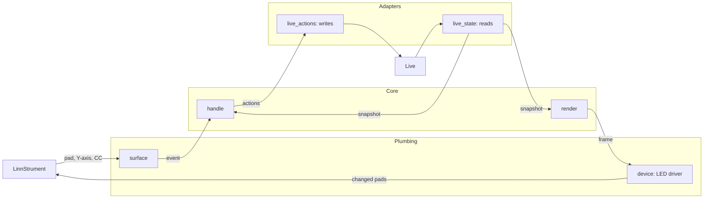
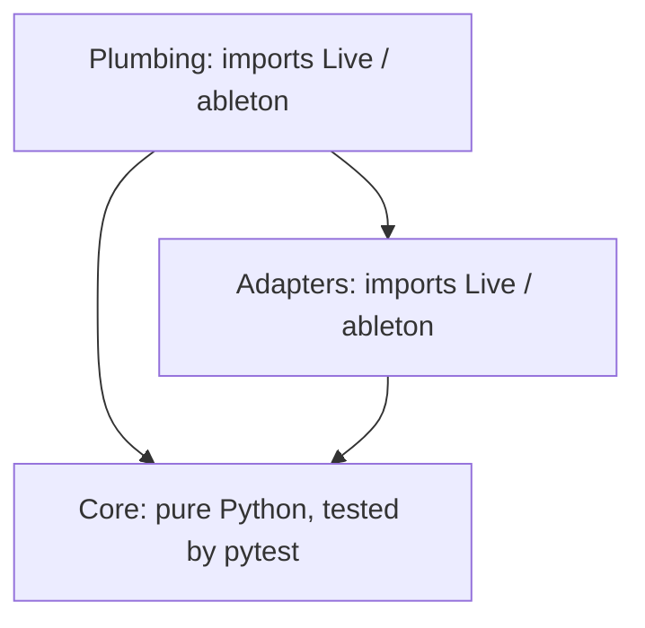
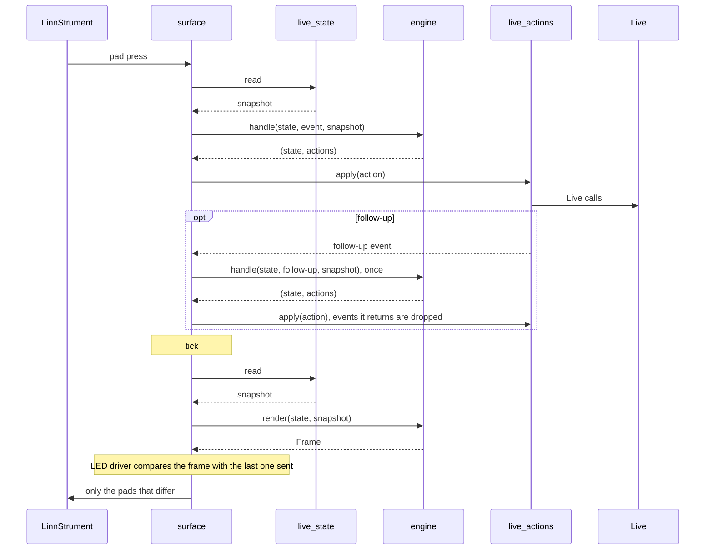
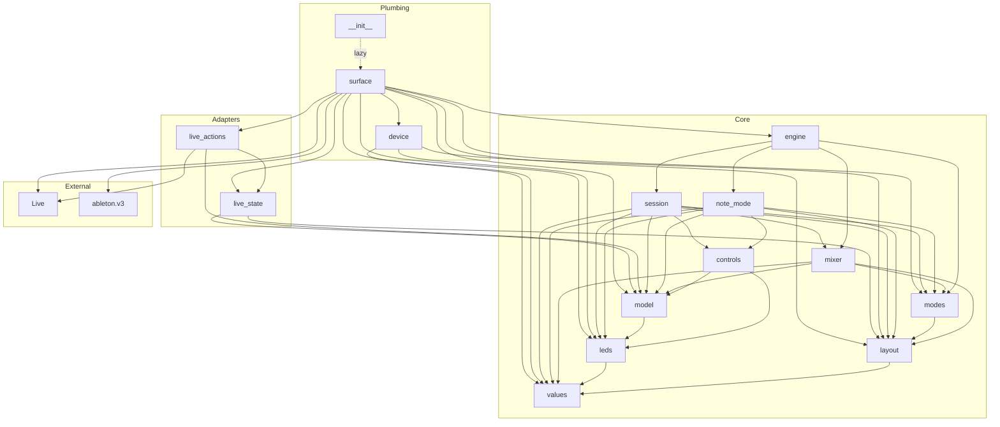
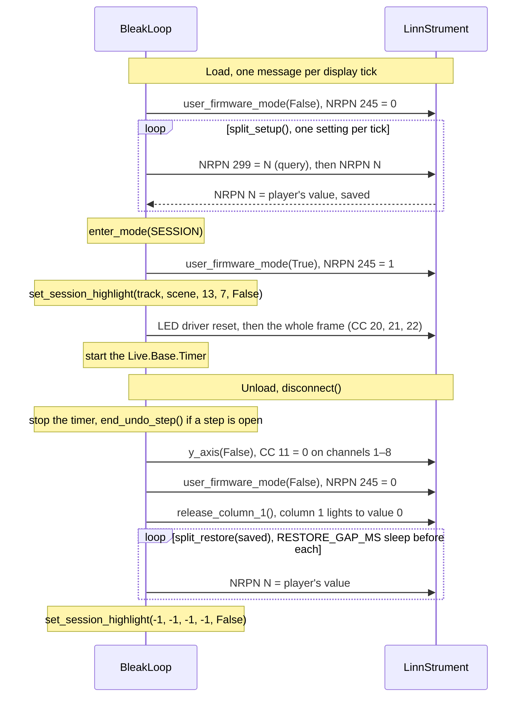
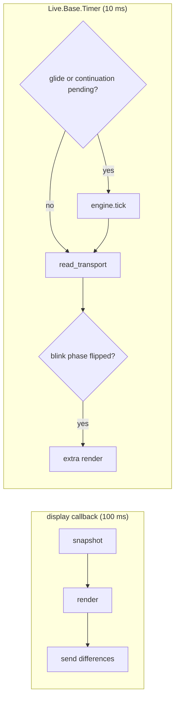
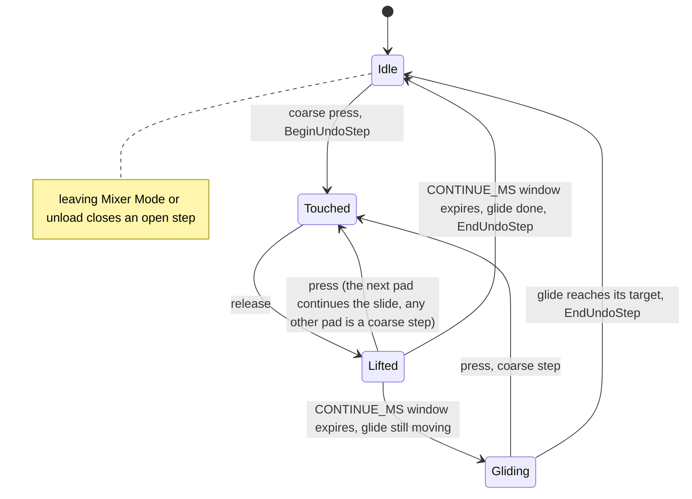
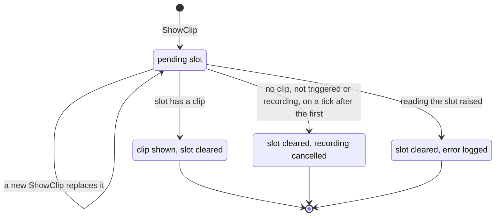

# BleakLoop architecture

How BleakLoop works today. This is a living document: any change to the structure, a device or Live mechanism, or a tuned value updates it in the same PR as the code.

## At a glance



**Where to look:**

| To change… | Look in |
| --- | --- |
| `create_instance` | `__init__.py` |
| Plumbing: `ControlSurface` subclass, elements, MIDI routing per mode, tick | `surface.py` |
| NRPN, split setup and LED message building, LED driver | `device.py` |
| Reading Live into a `Snapshot` | `live_state.py` |
| Carrying out an `Action` as Live calls | `live_actions.py` |
| Geometry: pad <-> device row, column roles, 13 x 7 window, window movement and clamping | `core/layout.py` |
| Snapshot, Action and Frame types (plain dataclasses) | `core/model.py` |
| Session / Mixer / Note, Note Mode pages, modifiers | `core/modes.py` |
| Shared Session and Note Mode behaviour: undo, metronome, Play/Stop, record, Fixed Length and scene lights | `core/controls.py` |
| Clip slots, copy and delete rules, bottom row, columns 1, 15, 16, Shift layer table | `core/session.py` |
| Mixer toggle, coarse steps, bands, smoothing | `core/mixer.py` |
| Column 1 controls page and scene page | `core/note_mode.py` |
| Device colours, track colour matching, tempo and fast blink | `core/leds.py` |
| Tuned numbers: every value in section 8, by name | `core/values.py` |
| `handle()` and `render()`, composing the core modules | `core/engine.py` |
| The generated manual pad maps and architecture figures | `tools/docs/` |

Read sections 2–4 for structure, 5–7 for device and Live details, and 8 for numbers.

## 1. Constraints

- Runs on Python 3.11, Live's embedded runtime. The folder `src/BleakLoop/` is the control-surface name and is never renamed.
- Built on an `ableton.v3` `ControlSurface`. `ableton.v3` is undocumented and ships only as `.pyc`, so BleakLoop uses as little of it as possible and only its widely used parts.

## 2. Layers

BleakLoop has three layers. Each may only import from the layers below it.



| Layer | Contents | Imports Live or `ableton`? | Tested by |
| --- | --- | --- | --- |
| Plumbing | `ControlSurface` subclass, MIDI elements, MIDI map and pass-through, session ring highlight, timer tick | Yes | Live restart and Log.txt |
| Adapters | Read Live state into plain snapshots; carry out core actions on Live objects | Yes (thin, no decisions) | Live restart |
| Core | All behaviour: modes, modifiers, Shift layer, grid, copy rules, mixer maths, colours, blinking | **No.** Pure Python | pytest, outside Live |

The plumbing uses v3's elements, MIDI map handling and lifecycle. v3's behaviour components (Session, Mixer, Transport, Clipboard, Modes and its modifier handling) are **not** used: their defaults differ from BleakLoop's copy, delete, arm and Shift behaviour, and they can't be tested outside Live. With v3's background layer excluded and no listeners attached, v3 elements pass the player's MIDI (notes, MPE, Y, pressure) through to tracks untouched. LED output doesn't use v3 elements: the LED driver sends raw MIDI through the control surface.

## 3. The core

The core is a state machine plus a renderer, with no side effects of its own.

- **Input:** `handle(state, event, snapshot) -> (state, actions)`.
  - `event` is a pad press or release, a Y-axis value, a Note Mode CC, or a tick.
  - `snapshot` is a plain, read-only view of the Live state the decision needs.
  - `actions` are plain values such as `FireSlot(track, scene, legato, record_length)`, `Undo()`, `SetVolume(track, value)` or `ShowMessage(text)`. The adapters carry them out.
- **Output:** `render(state, snapshot) -> Frame`. A frame is the colour of every pad the current mode owns: the 8 × 16 surface in Session and Mixer Mode, column 1 in Note Mode. A pad may blink; the LED driver resolves blinking pads with a `clock` that gives the tempo-blink and fast-blink phase.
- **Sending:** the LED driver compares each frame with the last frame sent and sends only the pads that differ, all in one pass, so blinking pads switch together. Clearing the remembered frame on a mode switch makes every pad correct after the switch.
- **Shift layer:** while Shift is held, `handle` looks up the Shift table and `render` draws the Shift layer. There's no per-element modifier wiring.



Snapshots are read fresh on each tick and each event. Polling is chosen for simplicity: 91 clip slots with several properties each, plus 13 tracks, 7 scenes and transport state, a few times a second. A full snapshot costs about 0.5 ms (3 ms at worst).

## 4. Module layout

The core starts coarse and a module is split when it grows.

```
src/BleakLoop/
  __init__.py          create_instance
  surface.py           plumbing: ControlSurface subclass, elements, MIDI routing per mode, tick
  device.py            pure: NRPN, split setup and LED message building, LED driver
  live_state.py        adapter: Live -> Snapshot
  live_actions.py      adapter: Action -> Live calls
  core/
    layout.py          geometry: pad <-> device row, column roles, 13 x 7 window, window movement and clamping
    model.py           Snapshot, Action and Frame types (plain dataclasses)
    modes.py           Session / Mixer / Note, Note Mode pages, modifiers
    controls.py        shared Session and Note Mode behaviour: undo, metronome, Play/Stop, record, Fixed Length and scene lights
    session.py         clip slots, copy and delete rules, bottom row, columns 1, 15, 16, Shift layer table
    mixer.py           Mixer toggle, coarse steps, bands, smoothing
    note_mode.py       column 1 controls page and scene page
    leds.py            device colours, track colour matching, tempo and fast blink
    values.py          every value in section 8, by name
    engine.py          handle() and render(), composing the modules above
tests/                 pytest: the core, the docs generators and the layering
  test_manual.py       every lit pad in the manual's example Sets is labelled; generated docs are current
  test_architecture.py core imports only core; adapters import no plumbing
tools/
  docs/                generated docs (standard library only)
    __main__.py        writes every generated file below; --check
    markers.py         rewrites generated text between marker comments
    svg.py             shared SVG palette and drawing primitives
    manual/            the player's manual
      scenes.py        one example Set per manual layer
      pads.py          pad labels and callout items, by manual section; each map joins its sections
      draw.py          one SVG pad map per layer: labels over the example lights
      generate.py      docs/manual/*.svg and the callout lists in docs/manual.md
    architecture/      this document
      imports.py       the module import graph, from the real imports
      figures.py       the section 5 orientation and colour figures
      generate.py      docs/architecture/*.svg and the import graph in docs/architecture.md
```

The manual's pad maps and callout lists are generated from `core/layout.py` and `render()`, and this document's import graph and section 5 figures from the code. `PYTHONPATH=src python3 -m tools.docs` writes them all, and CI and the pre-commit hook fail when the committed output is stale.

`__init__.py` imports nothing from `ableton` or `Live` at module level; `create_instance` imports `surface` inside the function. This keeps `BleakLoop.core` importable by pytest outside Live. Tests run on Python 3.11 (`uvx --python 3.11 pytest`) to match Live's runtime.

The import graph below is generated from the real imports, and `tests/test_architecture.py` fails if `core/` imports anything outside `core/`.

<!-- generated:imports -->

<!-- /generated:imports -->

## 5. Device interface

Sources (Roger Linn Design): [User Firmware Mode](https://github.com/rogerlinndesign/linnstrument-firmware/blob/master/user_firmware_mode.md), [MIDI input and colour values](https://github.com/rogerlinndesign/linnstrument-firmware/blob/master/midi.md), [Panel settings: CC Faders](https://www.rogerlinndesign.com/support/linnstrument-support-panel-settings), [Tips & tricks: one-column CC Faders split](https://www.rogerlinndesign.com/support/support-linnstrument-linnstrument-tips-tricks).

**Orientation.** Columns are counted from the player's left: column 0 is the device's own control switches, columns 1–16 the playing surface. Pads within a column run 1 (farthest row) to 8 (nearest). The device counts rows the other way, so device row = 8 − pad.


**Messages:**

- **User Firmware Mode:** NRPN 245 = 1 takes over the pads; 245 = 0 hands them back. Accepted on any channel. Every NRPN is CC 99 / 98 / 6 / 38 followed by the CC 101 / 100 = 127 reset. The device confirms each change as NRPN 245 on channel 9 about 20 ms later; BleakLoop doesn't listen for it.
- **Pad input** (User Firmware Mode): Note On for a press, Note Off (or Note On velocity 0) for a release. The channel is the device row (channel 1 = device row 0, the nearest) and the note number is the column. Column 0 reports like any pad and is ignored.
- **Lights:** CC 20 (column, from 0), CC 21 (device row, from 0), CC 22 (colour value).
- **Y-axis:** CC 11 = 1 on channels 1–8 turns reporting on per row, CC 11 = 0 off. Reports arrive as CC (64 + column) on the row's channel.
- **Control split** (Note Mode): set up on load as column 1 only, CC Faders, one-channel mode on the control channel, faders sending CC 102–109 nearest row first (NRPNs in section 8). Before each setting is changed, it's read with an NRPN 299 query sent in the same step, and on unload the player's values are written back. The player's right split is left untouched. BleakLoop listens for CC 102–109 on the control channel only; everything else passes through to Live's tracks.

**Colour values** (CC 22): red 1, yellow 2, green 3, cyan 4, blue 5, magenta 6, off 7, white 8, orange 9, lime 10, pink 11. Value 0 ("as set in Note Lights") also shows dark, but means device default and is used only to hand column 1's lights back on unload. On the device, lime looks yellow and green looks lime.


**Device behaviour BleakLoop depends on:**

- **NRPN changes are RAM only.** Flash is written only when the player commits a change on the panel (releasing Per-Split, Octave, Volume, Preset and the like), and each commit saves the whole config as it is in RAM. Checked on the device: an unload that doesn't restore leaves BleakLoop's split until a power cycle (E1). Panel buttons do nothing in User Firmware Mode (E2), but a commit in Note Mode saves BleakLoop's split to flash (E2′). BleakLoop never makes the device save.
- **NRPN 299 = N reads setting N.** The reply is a normal NRPN (CC 99 / 98 / 6 / 38, then 101 / 100 = 127) on the query's channel minus one, clamped to channel 1. BleakLoop queries on channel 1, so replies arrive there. NRPN 35 doesn't reply when its combination of special modes is unusual; that setting is then not restored.
- **The device applies light changes one at a time.** A full-grid flip leaves Live in under 1 ms but ripples visibly; BleakLoop never adds to it by spreading changes across refreshes.

> [!NOTE]
> **Bursts lose messages.** In a single burst of the split setup the device dropped a block of about 16–19 messages from the middle, so the split setup is paced one query and one NRPN per display tick (about 1.4 s at startup). On unload, the restore appended to the 38-message hand-back burst lost its last 18 messages, so each restore NRPN is sent after a `RESTORE_GAP_MS` sleep.

- **Control split pads are toggles.** Each press sends one CC: 127 if the device's stored value for that CC is 0, otherwise 0. A release sends nothing. The stored value follows any CC 102–109 the device receives on the control channel. Rows that share a CC are linked by the firmware, so every row must get its own.
- **Y is relative and dense.** Every press reports 64 first, after the note-on. Y swings to 127 or 0 over about half a pad and then stays saturated until the release. Reports arrive every 10–20 ms, 1–3 units apart.
- **A slide never overlaps pads.** The old pad's release comes first, then 160–460 ms of silence, then the next pad's press.
- **A still finger rolls.** Y drifts from 64 to about 85 within 100 ms of a press, and further over seconds.

## 6. Plumbing

### Elements and routing

- **Elements in User Firmware Mode:**
  - Pad presses: notes 0–16 on channels 1–8.
  - Y-axis values: CC 64 + column on channels 1–8, claimed only in Mixer Mode. Columns 2–14 (CC 66–78) become fader input; the other columns are claimed and dropped, because Y reporting is per row and their reports would otherwise reach Live's tracks.

> [!IMPORTANT]
> **Elements in Note Mode:** CC 102–109 on the control channel only, as plain CC buttons, never encoders. Encoders send the control CCs = 0 back to the device on every Note Mode entry, which resets its stored toggle values, and Live appears to drop a mapped CC that repeats the encoder's last value. Together that lost every other press.

- **NRPN replies:** CC 99, 98, 6, 38, 101 and 100 on channel 1, listened only during the setup, so the control split's queries can be read. Their listeners are removed when Session Mode is entered.
- **Routing per mode.** An element only intercepts MIDI while it has a listener, and v3's background layer listens to every element by default. So BleakLoop excludes every element from the background (`_should_include_element_in_background` returns False) and attaches listeners per mode. In Note Mode, only the eight control CCs are listened; everything else reaches Live's tracks.
- **LED output.** One "light pad" call sends CC 20, 21 and 22. The LED driver (section 3) is the only caller. v3's per-element send cache isn't relied on.

> [!IMPORTANT]
> **All device output is sent unoptimised** (`_send_midi(..., optimized=False)`). Inside input callbacks Live buffers "optimized" messages and keeps only the last one per status byte and CC number, which collapses LED triples and NRPN sequences to a single message. This is a hard rule.

### Device lifecycle

- **Device setup and mode.** On load, BleakLoop leaves User Firmware Mode, configures the control split (paced, section 5), then enters Session Mode. NRPN 245 is sent on entering Session and Note Mode. Each setup step queries a setting and then sets it; the device answers in order, so the reply is the player's own value. On unload, it turns Y-axis reporting off, leaves User Firmware Mode and returns column 1's lights to value 0 in one burst. It then writes back each split setting that replied, one NRPN per `RESTORE_GAP_MS` sleep, so the device is playable with the player's own split. A setting that never replied keeps BleakLoop's value.


### Clocks

- **Tick.** Two clocks. Live's display callback (a steady 100 ms) reads a snapshot, renders a frame and sends the differences. A `Live.Base.Timer` at 10 ms (measured: about 12 ms on average, 32 ms at worst) checks the blink phases and triggers an extra render when one flips, so tempo blinks land within about one timer period of the beat. The timer reads only the transport (`live_state.read_transport`); the full snapshot is read only when a frame is drawn. Sending MIDI, reading Live state and setting volumes are all allowed from the timer callback.


### Mixer

- **Mixer toggle.** `SetMixer(on)` sends the Y-axis CCs and re-listens, with the Y elements only when on, in one burst with the repaint that follows. There's no LED driver reset: nothing else has touched the device's lights, so the diff is accurate and the burst stays smaller.
- **Fader glide.** `engine.tick(state, now_ms)` runs from the 10 ms timer while any glide or pending continuation exists; it also expires continuation windows and times each press, since events carry no time. A press takes Y relative to its first report, and a press next to a pad released within `CONTINUE_MS` continues the slide, bridging the gap between pads. During a continued slide the glide moves at the measured pad pace (section 8). It needs no snapshot and moves each volume toward its target by an amount scaled by the elapsed time. The surface redraws only when a fader's lit height changes, since the fader shows only 8 heights.


### Follow-up events

- **Follow-up events.** `live_actions.apply` may return an event, which `_handle` feeds to the core once after the action loop. The follow-up's own actions are applied, but any events they return are dropped, so this never recurses. Used by Capture: after `song.capture_and_insert_scene()` the adapter returns `SceneSelected` with the index of `song.view.selected_scene` (already updated when the call returns), and the core scrolls the window the minimum distance.
### Detail view

- **Detail-view focus is polled on the display tick.** Live refuses changes made inside a listener callback, and polling needs no listener lifecycle. The surface holds one pending clip slot, and a new `ShowClip` replaces it. On each tick:
  - If the slot has a clip, the surface shows it and clears the pending slot.
  - On any tick after the first, if the slot has no clip and is neither triggered nor recording, the recording was cancelled. The pending slot is cleared, so a clip that lands there later doesn't take the view.
  - If reading the slot raises (its track or scene was deleted), the error is logged and the pending slot is cleared.

> [!IMPORTANT]
> `highlighted_clip_slot` is never set, because that would change the selected track and, with auto-arm, which track is armed.


### Session ring

- **Session ring.** `c_instance.set_session_highlight(track, scene, 13, 7, False)` draws it from the core's window state whenever the window changes and on every Session entry; `(-1, -1, -1, -1, False)` removes it on Note entry and on unload. v3 draws no ring of its own. Live picks the ring's colour, not BleakLoop.

## 7. Adapters: Live mechanisms

| Behaviour | Mechanism |
| --- | --- |
| Clip and scene launch | `ClipSlot.fire()` and `Scene.fire()`. Legato passes `force_legato=True`, which the LOM doesn't document but Live accepts, also together with `record_length`. |
| Fixed Length | `ClipSlot.fire(record_length=beats)`, with beats = N × numerator × 4 / denominator. Passed only for an empty slot on an armed track, the only case where Live starts a new recording (`fire` raises if the slot owns a clip). Live records the exact length natively, from a stopped transport and with quantization None, so no relaunch timer is needed. |
| Detail view focus | Poll the pending slot on the display tick; set `song.view.detail_clip` and show `Detail/Clip` (section 6). |
| Auto Note Mode | The core decides from the snapshot (track type, arm, slot state and Session Record) and emits a mode-switch action. |
| Launch quantization | `song.clip_trigger_quantization = Live.Song.Quantization.values[n]`, read back with `int(...)`. Names in `session.QUANTIZATION_NAMES` match Live's dropdown. The remembered choice is core state, not Live. |
| Track and global stop | `Track.stop_all_clips()`, `Song.stop_all_clips()`. Both stop at the next launch quantization mark, like Live's own stop buttons, on purpose. |
| Arm | Exclusive arm disarms the others in `song.tracks`, then sets `track.arm`. Tracks are compared with `!=`, not `is`, because `song.tracks` and `song.visible_tracks` may return different wrappers for one track. `live_state` reads `arm` and `implicit_arm` only when `can_be_armed` is true, because Live is expected to raise on unarmable tracks such as groups. Both guards are deliberate. |
| Track list | `song.visible_tracks`: folded group members are skipped, and unfolding shifts the columns. |
| Status bar messages | `ShowMessage` action, through v3's `ControlSurface.show_message`. |
| Clip copy | `ClipSlot.duplicate_clip_to`. It raises on a MIDI/audio mismatch and on group slots, so the core refuses both first, using the track's `has_midi_input` and `is_foldable`. |
| Group slots | Live reports a group track's slot as having no clip, even when its members hold clips (#12, #13). |
| Scene copy | Every track in `song.tracks` except group tracks, including folded group members. `live_state` reads "scene has a clip" across them only while Copy is held, when the window can't move. |
| Clip and scene delete | `ClipSlot.delete_clip()`, `song.delete_scene()`. |
| Quantize | `clip.quantize(Live.Song.RecordingQuantization.rec_q_sixtenth, 1.0)`. Three candidates (highlighted slot's clip, `song.view.detail_clip`, the selected track's `playing_slot_index` clip), resolved by one helper, `live_state.candidate_clip`, used by both the snapshot and the action. |
| Record pad | Session View: toggle `song.session_record`. Arrangement View: clear `song.back_to_arranger` if set, then toggle `song.record_mode`. Session View's record light counts MIDI Arrangement Overdub, on purpose. |
| Track volume | Read and set `track.mixer_device.volume.value`, clamped to the parameter's `min`/`max`. A glide for a track index that no longer exists is skipped. |
| Fader gesture undo | `song.begin_undo_step()` on the first coarse press and `song.end_undo_step()` once no touch, continuation window or glide is left, so one gesture is one undo step. The core tracks the open step (`State.undo_open`); leaving Mixer Mode and unload close it. |
| Record Clip | `live_state` reads the selected track (`song.view.selected_track`, only if it's in `song.visible_tracks`) and every scene of its slots, plus `song.view.selected_scene`, only in Note Mode. The core searches from the highlighted scene down, wrapping. When no slot is empty, `song.create_scene(-1)` runs before `FireSlot`: actions resolve their slot when applied, so the new scene exists by then. |
| Capture MIDI | `song.capture_midi()` with no argument, only when `song.can_capture_midi` is true; otherwise the core posts "Nothing to capture". |

## 8. Values

Every tuned number lives here with its reason and status. Code reads them from `core/values.py` by name and never repeats them as literals. Device protocol numbers are in section 5.

| Value | Used by | Source | Status |
| --- | --- | --- | --- |
| `CONTROL_CHANNEL`: control split channel | Note Mode controls | Named constant edited by the player | Default channel 1, confirmed |
| Control split setup NRPNs: 200 = 1 (split on), 202 = `SPLIT_POINT` = 2 (left split is column 1), 0 = 0 (one channel), 1 = channel, 35 = 2 (CC Faders), 40–47 = 102–109 (faders send CC 102–109) | `device.split_setup`, each preceded by its query | Device protocol | Confirmed on device |
| NRPN 299 = N: query setting N, answered as NRPN N | `device.query` | Device protocol | Confirmed on device |
| `RESTORE_GAP_MS = 20`: sleep before each unload restore NRPN | `surface.disconnect` | Tuned: 0 lost the last 18 messages, 20 restored all 13 | Confirmed on device |
| `CONTROL_CC_BASE = 102`: control split CCs 102–109, nearest row first | Note Mode controls | Chosen: undefined in General MIDI, clear of CC 1–8, LED CCs 20–22 and Y-axis CCs 64–80 | Confirmed on device |
| Off colour value: 7 | `leds` | Device protocol | Confirmed; 0 also dark |
| `FAST_BLINK_MS = 200`: fast blink, 200 ms on, 200 ms off | `leds` | Tuned | Verify on device (#25) |
| Light refresh: Live's display callback, about 100 ms | `surface` | Mechanism | Measured |
| `BLINK_TIMER_MS = 10`: blink clock, `Live.Base.Timer` | `surface` | Mechanism | Confirmed |
| `TRACK_COLOUR_REFERENCES`: reference RGB per device colour, fitted to Live 12's 70-colour palette (pinned in `tests/test_leds.py`) | `leds` track colour matching | Tuned by eye | Tuned on device; refine if a swatch looks wrong |
| `TEMPO_MIN = 20`, `TEMPO_MAX = 999`: tempo nudge limits | Shift + column 15 | Live's tempo range | Matches Live |
| `VOLUME_ZERO_DB = 0.85`: Live volume control position for 0 dB (1.0 = +6 dB) | `mixer` | Live behaviour | Confirmed |
| `VOLUME_MAX = 1.0`: top of Live's volume range (+6 dB), where fine setting stops | `mixer` | Live behaviour | Confirmed |
| `GLIDE_STEP = 0.018`: fader glide, at most 1.8 % of range per 10 ms, scaled by elapsed time | `mixer` | Tuned | Tune on device (#15, #25) |
| `GLIDE_DEAD_BAND = 0.003`: Y reports moving the target less than 0.3 % of range are ignored, and a glide this close snaps to its target | `mixer` | Tuned | Tune on device (#15, #25) |
| `CONTINUE_MS = 600`: a press next to a pad released within this time continues the slide (device gaps 160–460 ms, section 5) | `mixer` | Tuned | Tune on device (#15, #25) |
| Slide pace: during a continued slide the glide moves one step per press-to-press period of the last pad crossed, never faster than `GLIDE_STEP` | `mixer` | Derived | Tune on device (#15, #25) |
