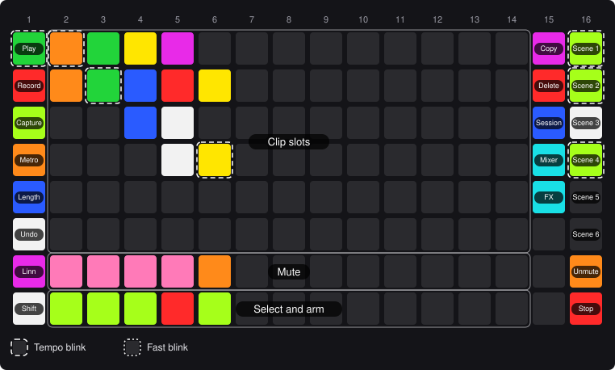
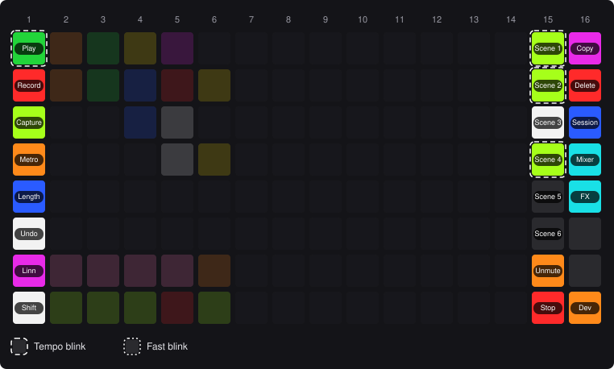
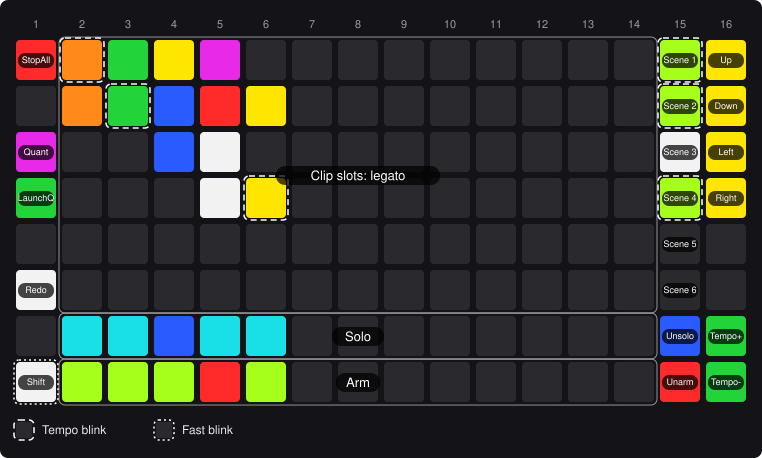
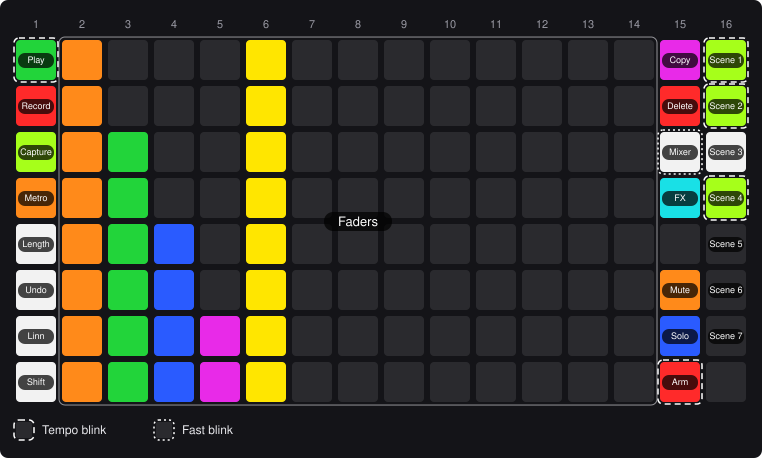
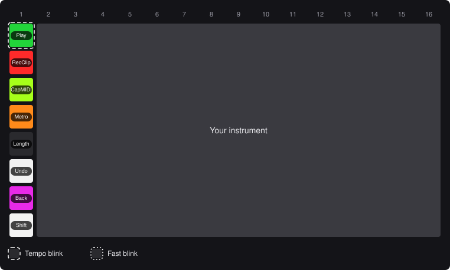
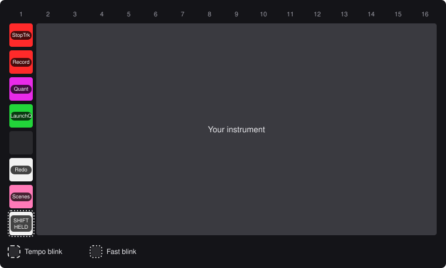
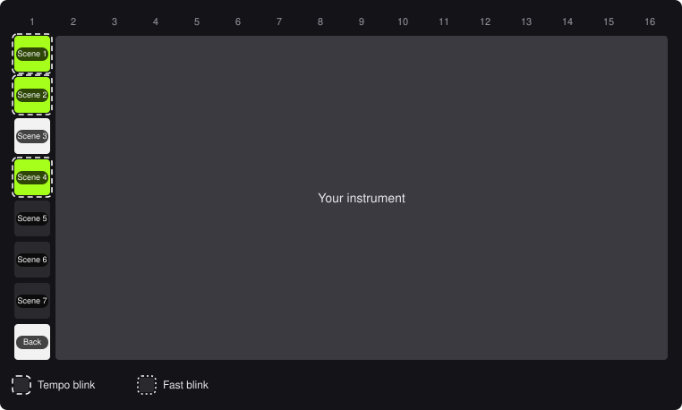

# BleakLoop player's manual

BleakLoop turns a LinnStrument 128 into a clip launcher, mixer and transport for Ableton Live 12. One pad hands the surface back to you as an instrument.

> **Heads-up:** if a press seems to do nothing, look at Live's status bar. When BleakLoop refuses something, it says why there.

## 1. Setup

1. Copy the `src/BleakLoop/` folder into Live's Remote Scripts folder.
2. In Live's Control Surface preferences, choose **BleakLoop**, with the LinnStrument as Input and Output.

While BleakLoop loads, a rainbow rolls across the pads for about 3 seconds, and the pads don't play. Then BleakLoop starts in Session Mode. Its Linnstrument Mode controls use a MIDI channel that your right split doesn't use. Only if your right split uses all 16 does BleakLoop borrow one of its MPE channels, and it gives it back when Live closes.

While Live runs, BleakLoop turns the LinnStrument's split on and makes column 1 its control split. When Live closes, or you choose another control surface, it puts your own split settings back.

## 2. Finding your way

- Columns are numbered 1–16 from the left, pads 1–8 from the far edge.
- Columns 2–14, pads 1–7, show a 13-track by 7-scene window onto Live's session. Live draws a ring around it.
- Shift, Copy and Delete work while held.
- Each map shows the pads' names over their colours in an example Set. A dashed ring blinks with the beat; a dotted ring blinks fast.

## 3. Session Mode

<!-- callouts:session -->
- **Clip slots**: Launch a clip. On an armed track, an empty slot records. *(Shift: Launch with legato)*
- **Track switches**: Mute, solo or arm the track, as set by the track switch mode. *(Shift: Stop the track's clips, in Mute mode)*
<!-- /callouts:session -->

**Clip colours:**

- Track colour, blinking: playing.
- Track colour: has a clip.
- Yellow: about to launch.
- Red: recording.
- White: empty, ready to record.

Recording on a MIDI track switches to Linnstrument Mode, so you can play straight away.

**Track switch colours:**

- Mute: orange while audible, lime while muted.
- Solo: blue while soloed, lime otherwise.
- Arm: red while armed, lime otherwise. Arming a track disarms the others.

## 4. Side columns

Columns 1, 15 and 16 work the same in Session and Mixer Mode. Column 1 is also the same in Linnstrument Mode (section 7), where Record, Capture and Shift + Play act on the selected track.

**Fixed Length** is one pad: its colour shows the length, white while off, then cyan, blue, magenta and pink. The length stays when you change mode.

Pads 4 and 5 of column 15 and pad 8 of column 16 are dark and do nothing: they're kept for modes still to come.

<!-- callouts:side -->
- **Play**: Start/stop. Blinks on the beat while playing. *(Shift: Stop all clips. In Linnstrument Mode, stops the selected track's clips)*
- **Record**: Session Record on/off (Arrangement Record in Arrangement View). Blinks while recording. In Linnstrument Mode, records a new clip on the selected track.
- **Capture**: Capture and Insert Scene. In Linnstrument Mode, captures MIDI. *(Shift: Quantize the current MIDI clip to 1/16 notes)*
- **Metronome**: Metronome on/off. Blinks while on. *(Shift: Launch quantization on/off; red while off)*
- **Fixed Length**: Record new clips at exactly 1, 2, 4 or 8 bars. Each press steps to the next length, then off.
- **Undo**: Undo. *(Shift: Redo)*
- **Linnstrument Mode**: Switch to Linnstrument Mode.
- **Shift**: Hold for the Shift layer.
- **Copy**: Hold, press a clip, then an empty slot. *(Shift: Move the window up)*
- **Delete**: Hold, then press a clip or scene to delete it. *(Shift: Move the window down)*
- **Mixer**: Mixer Mode on/off. Blinks while on. *(Shift: Move the window left)*
- **Track switch mode**: What the track switches do: Mute, Solo or Arm. The chosen one blinks. *(Shift: Tempo +1 BPM on Solo, -1 BPM on Arm)*
- **Scenes**: Launch a scene. *(Shift: Launch with legato)*
<!-- /callouts:side -->

**Copying:**

- Clips copy MIDI to MIDI and audio to audio, into an empty slot.
- To copy a scene, press it, then press an empty scene.
- Keep holding Copy to make more copies.

**Scenes** are lime and blinking while playing, and white if they hold clips.

## 5. Shift

Shift is pad 8 of column 1, nearest you, and works in every mode. Hold it for a second layer. The lists above give each pad's Shift function in italics: Shift + Undo is Redo, Shift + Play stops all clips, and column 15's top four pads move the window. Unlit pads do nothing, and in Mixer Mode the faders go dark.

**Quantize** works on the highlighted clip. If there isn't one, it uses the clip in Live's Detail view, then the selected track's playing clip.

## 6. Mixer Mode

<!-- callouts:mixer -->
- **Faders**: One volume fader per track.
<!-- /callouts:mixer -->

- Press a pad to set the volume: pad 1 is 0 dB, and each pad below it is a step quieter.
- Keep your finger down and slide to fine-tune, up to Live's maximum.
- Slide on to the next pad to keep going.
- One slide is one undo.
- Copy and Delete do nothing here.

## 7. Linnstrument Mode

The LinnStrument is your instrument again. Column 1 keeps the controls it has in Session Mode, so the pads are where you know them. You're playing the selected track, so Record records a new clip on it, Capture captures MIDI to it, and Shift + Play stops its clips. Column 1 always opens on the controls page.

> **Careful:** in Linnstrument Mode the LinnStrument's own panel buttons work again. Changing a setting there (Octave, Volume, Per-Split, Split and the like) saves BleakLoop's control split as your own, along with any MPE channel it borrowed. To undo that, close Live and set your split up again on the device. If you change the left split's Octave or Transpose, BleakLoop puts them back, so select the right split first. BleakLoop follows a Row Offset change within about a second. A Row Offset that repeats notes in column 1 (zero offset, or a guitar tuning with repeated strings) turns column 1's controls off, with a message. If you move the right split onto column 1's channel, BleakLoop moves column 1 to a free channel, with a message. If the right split uses every channel, column 1's controls go off until one is free again.

### Controls page

<!-- callouts:linnstrument -->
- **Play**: Start/stop. Blinks on the beat while playing. *(Shift: Stop the selected track's clips)*
- **Record Clip**: Record a new clip on the selected track. *(Shift: Session Record on/off (Arrangement Record in Arrangement View). Blinks while recording)*
- **Capture MIDI**: Capture MIDI. *(Shift: Quantize the current MIDI clip to 1/16 notes)*
- **Metronome**: Metronome on/off. Blinks while on. *(Shift: Launch quantization on/off; red while off)*
- **Fixed Length**: Record new clips at exactly 1, 2, 4 or 8 bars. Each press steps to the next length, then off.
- **Undo**: Undo. *(Shift: Redo)*
- **Session Mode**: Back to Session Mode. *(Shift: Show the scene page)*
- **Shift**: Hold for the Shift layer.
<!-- /callouts:linnstrument -->

**Record Clip** needs an armed track. It records into the next empty slot down from the highlighted scene, and adds a scene if there's none. Fixed Length applies.

### With Shift held

Shift + Record is Session Record, and Shift + Session Mode opens the scene page.

### Scene page

Shift + Session Mode opens it. Press a scene to launch it, or press Shift again to go back without launching.

<!-- callouts:linnstrument-scenes -->
- **Scenes**: Launch a scene and go back to the controls.
- **Back**: Back to the controls without launching.
<!-- /callouts:linnstrument-scenes -->

## 8. Lights

- **Tempo blink** (dashed ring): on the beat while playing, and at the Set's tempo while stopped.
- **Fast blink** (dotted ring): something held or chosen.
- **Track colours** use the closest LinnStrument colour.
- On the LinnStrument, lime looks yellow and green looks lime.
