# BleakLoop player's manual

<!-- Generated from tools/docs/manual/manual.md by PYTHONPATH=src python3 -m tools.docs. Edit that file, not this one. -->

BleakLoop turns a LinnStrument 128 into a clip launcher, mixer and transport for Ableton Live 12. One pad hands the surface back to you as an instrument.

> **Heads-up:** for more information, look at Live's status bar. Every press says what it did, such as "Metronome: ON", and holding Shift, Copy, Delete, Stop, Seq, Device/Clip or a Bars pad says what it opens. When a press can't work, the status bar says why.

## 1. Setup

1. Copy the `src/BleakLoop/` folder into Live's Remote Scripts folder.
2. In Live's Control Surface preferences, choose **BleakLoop**, with the LinnStrument as Input and Output.

While BleakLoop loads, a rainbow rolls across the pads for about 3 seconds, and the pads don't play. Then BleakLoop starts in Session Mode. Its Linnstrument Mode controls use a MIDI channel that your right split doesn't use. Only if your right split uses all 16 does BleakLoop borrow one of its MPE channels, and it gives it back when Live closes.

While Live runs, BleakLoop turns the LinnStrument's split on and makes column 1, the Global column, its control split. When Live closes, or you choose another control surface, it puts your own split settings back.

[Where every button is, and what it says](buttons.md): the button reference, for the layout BleakLoop ships with. To move a button or change what it says, see [Changing the buttons](#changing-the-buttons).

### Changing the buttons

While Live runs, open **http://127.0.0.1:47128** in your browser: BleakLoop's button editor. Live's Log.txt has the same address, on the line `BleakLoop editor:`. The page is only reachable from your own computer.

- Pick a section on the left, and Base or Shift held above the grid. Drag a button to a free pad to move it, or onto another button to swap the two. Click a pad to change its function or label, remove it, or put it back as shipped; click a free pad to add a button.
- Functions and System messages change what the status bar says. Each message lists the placeholders, such as `{bpm}`, it may use.
- Nothing changes until you press **Save**. BleakLoop checks the whole layout first: if anything clashes, the page says why and nothing is saved. Once saved, the new layout works at once, without restarting Live. If you're holding a pad, it waits until you let go.
- **Reset all** deletes your changes and goes back to the layout BleakLoop ships with.

Your changes are saved in `User Library/BleakLoop/buttons.toml`, beside the Remote Scripts folder, so installing a new BleakLoop keeps them. The file lists only what you changed: everything else, including buttons and messages a new version adds, comes from the shipped `src/BleakLoop/buttons.toml`. Deleting the file resets everything. You can also edit it in a text editor: BleakLoop applies each save within about a second, or, if the file has a mistake, keeps the current layout and shows the error. While your file has a mistake, the editor says what it is and shows the layout without your file. Saving or resetting then keeps a copy of the old file as `buttons.toml.bak` first. The editor rewrites the whole file on each save, so comments you add by hand are lost.

- A full copy of the shipped file works as a starting point: the `manual` fields it carries are accepted while they match the shipped ones. Changing them does nothing for the device, so it's refused. Everything in a copy overrides the shipped file, so a button a new version moves stays where your copy has it.
- FX snapshot slots, scene slots, Sequencer pages, Bars, rates, tracks and devices can be moved and relabelled, but not added, removed or given another value. Tempo and window buttons can be added, removed and given any step.
- A section that falls back to another one, such as Linnstrument Mode's Global column, shows the fallback's buttons where it has none of its own. Removing its own button brings the fallback's back on that pad.
- To turn the editor off, or move it to another port, add this to your file. BleakLoop applies it on the next save, and says so if the port is taken:

  ```toml
  [editor]
  enabled = false
  port = 47128
  ```

To check a file by hand, from the repo: `PYTHONPATH=src python3 -m tools.check_buttons --user PATH`.

## 2. Function Reference

### Overview

- **Session Mode** launches clips and scenes, and mutes, solos and arms tracks. Its split view adds eight faders or the FX snapshots.
- **Mixer Mode** gives each track a volume fader. Its split view adds eight faders or the FX snapshots, as Session Mode's does.
- **FX Mode** has eight faders for a device or for parameters you bind, and snapshots of every rack's macros that recall at once or morph.
- **Sequencer Mode** is a 64-step sequencer on a MIDI clip, with note pads.
- **Linnstrument Mode** gives the LinnStrument back to you as an instrument, its panel buttons in column 0 included. Only the Global column stays.

How to read the surface:

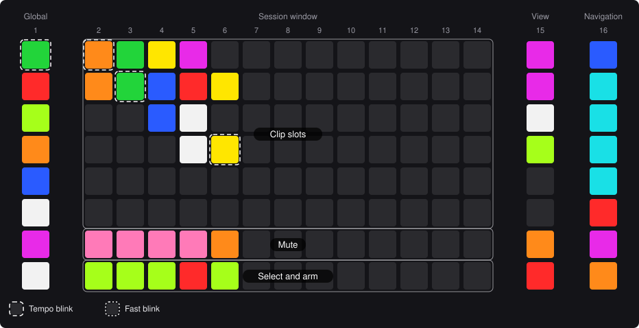

- Columns are numbered 1–16 from the left, pads 1–8 from the far edge.
- Columns 2–14, pads 1–6, show a 13-track by 6-scene window onto Live's session. Live draws a ring around it in every mode, so you can always see which scenes the scene pads launch. Pads 7 and 8 of each column mute and arm that track. The split view narrows the window to 8 tracks.
- Shift + column 16, pads 5–8 move the window in every mode but Linnstrument Mode.
- Shift, Copy, Delete, Stop and Device/Clip work while held. Shift (column 1, pad 8) works in every mode: each list is followed by what its pads do with Shift held, and each mode has a map with Shift held. Unlit pads do nothing.
- Each map shows the pads' names over their colours in an example Set. A dashed ring blinks with the beat; a dotted ring blinks fast.

### Columns

#### Global - Left

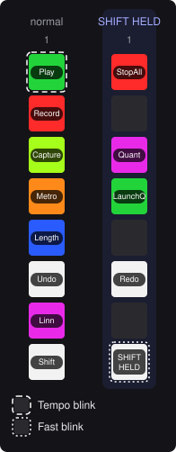

The Global column (column 1) holds the transport, recording, Undo and Shift, the same in every mode. In Linnstrument and Sequencer Mode, Record, Capture and Shift + Play act on the selected track.

<!-- callouts:global -->
- **Play**: Start/stop. Blinks on the beat while playing.
- **Record**: Session Record on/off (Arrangement Record in Arrangement View). Blinks while recording. In Linnstrument Mode, records a new clip on the selected track.
- **Capture**: Capture and Insert Scene. In Linnstrument Mode, captures MIDI.
- **Metronome**: Metronome on/off. Blinks while on.
- **Fixed Length**: Record new clips at exactly 1, 2, 4 or 8 bars. Each press steps to the next length, then off.
- **Undo**: Undo.
- **Linnstrument Mode**: Switch to Linnstrument Mode.
- **Shift**: Hold for the Shift layer.

With **Shift** held:

- **Stop all**: Stop all clips. In Linnstrument Mode, stops the selected track's clips.
- **Quantize**: Quantize the current MIDI clip to 1/16 notes.
- **Launch quantization**: Launch quantization on/off; red while off.
- **Redo**: Redo.
<!-- /callouts:global -->

<br clear="right">

#### View - Inner Right

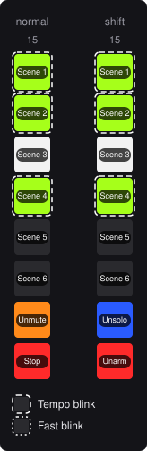

Column 15, next to the grid, holds the window's scenes, Unmute all and Stop, in Session, Mixer and FX Mode. Sequencer Mode has its own.

<!-- callouts:view -->
- **Scenes**: Launch a scene. Its FX snapshot, if it has one, lands as it starts.
- **Unmute all**: Unmute every track and return track in the Set. Orange while any is muted.
- **Stop**: Hold, then press a track's pad to stop that track's clips.

With **Shift** held:

- **Scenes**: Launch with legato, leaving the FX snapshot alone.
- **Unsolo all**: Unsolo every track and return track in the Set. Blue while any is soloed.
- **Unarm all**: Disarm every track in the Set. Red while any is armed.
<!-- /callouts:view -->

<br clear="right">

#### Navigation - Right

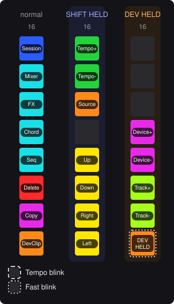

The outer edge, column 16, holds the mode pads, then Delete and Copy. **Device/Clip** (pad 8) flips Live between Device and Clip view when tapped, or shows the Device/Clip layer of tracks and devices while held.

<!-- callouts:navigation -->
- **Session**: Session Mode. In Session Mode, toggles the split view.
- **Mixer**: Mixer Mode. In Mixer Mode, toggles the split view.
- **FX**: FX Mode. Press again for Session Mode.
- **Seq**: Hold and press a clip, or tap, for Sequencer Mode.
- **Delete**: Hold, then press a clip or scene to delete it.
- **Copy**: Hold, press a clip, then an empty slot.
- **Device/Clip**: Tap to flip Live between Device and Clip view. Hold for the Device/Clip layer: tracks and devices.

With **Shift** held:

- **Tempo**: Tempo +1 or -1 BPM.
- **Panel**: Switch Session and Mixer Mode's split view panel between Device FX and the snapshots. Does nothing in FX or Sequencer Mode.
- **Window directions**: Move the Ableton session ring in the selected direction.
<!-- /callouts:navigation -->

With **Device/Clip** held:

<!-- callouts:device-clip -->
- **Devices**: Select the previous or next device on the selected track.
- **Tracks**: Select the previous or next track, through the returns and master, and give its first rack the blue hand.
- **Device/Clip**: Hold it for this layer. A tap, pressing nothing else, flips Live between Device and Clip view instead.
<!-- /callouts:device-clip -->

<br clear="right">

### Session Mode

- A slot shows its clip in the track's colour, blinking while it plays. Yellow is about to launch, red is recording, and white is an empty slot ready to record.
- Recording on a MIDI track switches to Linnstrument Mode, so you can play straight away.
- Pad 7 mutes the track, or solos it with Shift held. Pad 8 selects and arms it, or arms it alone with Shift held. Shift + Stop disarms every track.
- Session (column 16, pad 1) turns the split view on and off.

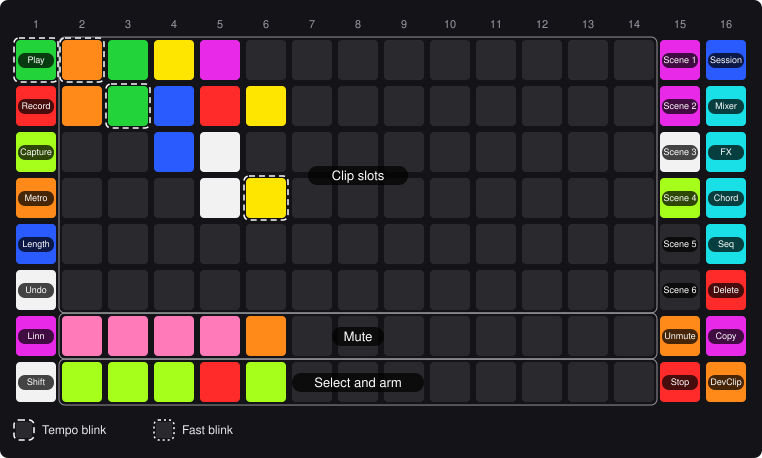

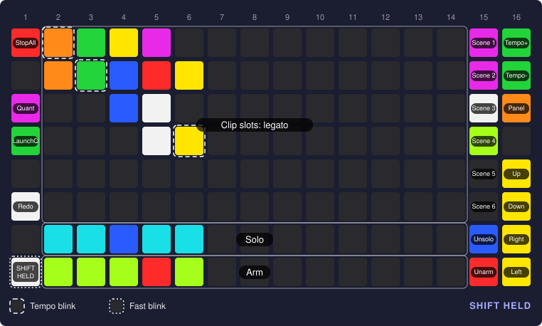

<!-- callouts:session -->
- **Clip slots**: Launch a clip. On an armed track, an empty slot records.
- **Mute**: Mute or unmute the track: pink while audible, orange while muted.
- **Select and arm**: Select the track, arm it alone and give its first rack the blue hand.

With **Shift** held:

- **Clip slots: legato**: Launch with legato.
- **Solo**: Solo or unsolo the track, as Live's Exclusive Solo preference says: cyan, blue while soloed.
- **Arm**: Arm or disarm the track alone, keeping the selection.
<!-- /callouts:session -->

#### Split view

The split view shows 8 tracks and a panel side by side. Press Session (column 16, pad 1) while in Session Mode to turn it on or off, with a message. Session is pink while the split view is on. The panel shows eight Device FX faders or FX Mode's snapshots: Shift + FX switches between them.

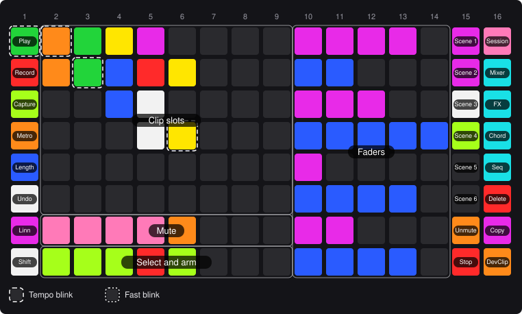

<!-- callouts:split -->
- **Clip slots**: Launch a clip. On an armed track, an empty slot records.
- **Mute**: Mute or unmute the track: pink while audible, orange while muted.
- **Select and arm**: Select the track, arm it alone and give its first rack the blue hand.
- **Faders**: One Device FX fader per row, as in FX Mode. Shift + FX shows the snapshots instead.

With **Shift** held:

- **Clip slots: legato**: Launch with legato.
- **Solo**: Solo or unsolo the track, as Live's Exclusive Solo preference says: cyan, blue while soloed.
- **Arm**: Arm or disarm the track alone, keeping the selection.
<!-- /callouts:split -->

With the snapshots in the panel, columns 10–14 work as FX Mode's.

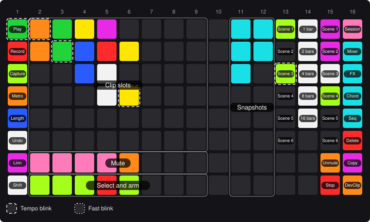

<!-- callouts:split-snapshots -->
- **Clip slots**: Launch a clip. On an armed track, an empty slot records.
- **Mute**: Mute or unmute the track: pink while audible, orange while muted.
- **Select and arm**: Select the track, arm it alone and give its first rack the blue hand.
- **Bars**: Hold one, then press a snapshot to morph to it over 1, 2, 4, 8 or 16 bars, or a scene to launch it on that bar line.
- **Snapshots**: Sixteen snapshots per bank of every rack's macros: slots 1–8 in column 11, 9–16 in column 12. Press an empty slot to store. Tap a stored one to recall it, or slide right from it to blend towards it. Shift + a slot binds the parameter clicked in Live to it, in pink.
- **Banks**: Eight banks of sixteen snapshots: press one to show its slots. The selected bank is orange. Every Set opens on bank 1.
- **Scene snapshots**: A snapshot per scene, scrolling with the scene pads. Press an empty one to store, a stored one to recall. Launching the scene morphs to it.

With **Shift** held:

- **Clip slots: legato**: Launch with legato.
- **Solo**: Solo or unsolo the track, as Live's Exclusive Solo preference says: cyan, blue while soloed.
- **Arm**: Arm or disarm the track alone, keeping the selection.
<!-- /callouts:split-snapshots -->

### Mixer Mode

- Pads 1–6 of each track are its volume fader: pad 1 is 0 dB. Slide to fine-tune.
- With Shift held the faders go dark, and pads 7 and 8 show their Shift layer: solo, and arm alone.
- Copy and Delete do nothing here, except on the split view's snapshots.
- Press Session for Session Mode. FX and Mixer Mode replace each other.
- Press Mixer again for the split view.

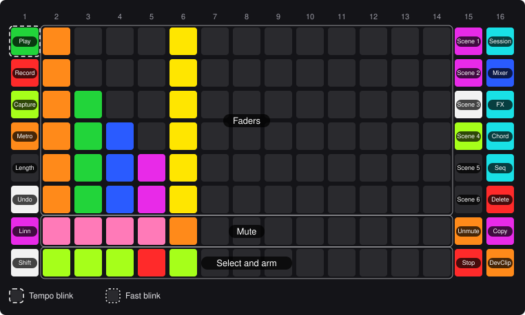

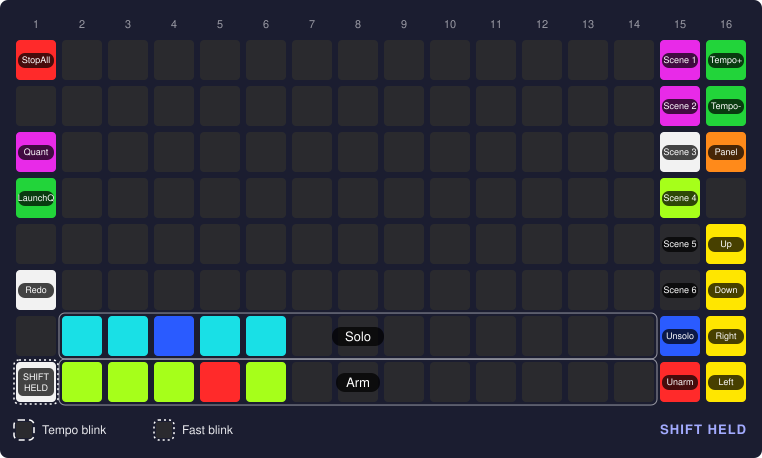

<!-- callouts:mixer -->
- **Faders**: One volume fader per track.
- **Mute**: Mute or unmute the track: pink while audible, orange while muted.
- **Select and arm**: Select the track, arm it alone and give its first rack the blue hand.

With **Shift** held:

- **Solo**: Solo or unsolo the track, as Live's Exclusive Solo preference says: cyan, blue while soloed.
- **Arm**: Arm or disarm the track alone, keeping the selection.
<!-- /callouts:mixer -->

#### Mixer split view

The split view shows 8 tracks' volume faders and the same panel as Session Mode's split view: eight faders or the snapshots, whichever Shift + FX last picked. Press Mixer (column 16, pad 2) while in Mixer Mode to turn it on or off, with a message. Mixer is pink while the split view is on.

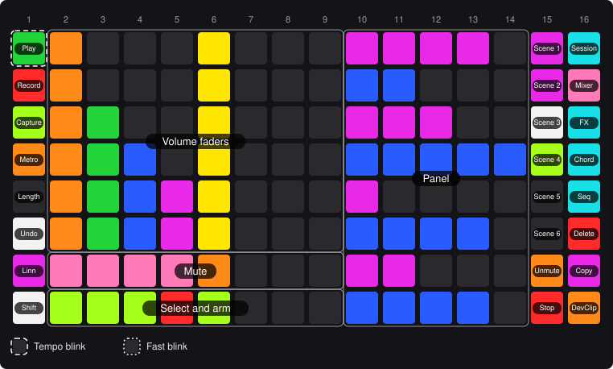

<!-- callouts:mixer-split -->
- **Volume faders**: One volume fader per track.
- **Mute**: Mute or unmute the track: pink while audible, orange while muted.
- **Select and arm**: Select the track, arm it alone and give its first rack the blue hand.
- **Panel**: One Device FX fader per row, as in FX Mode. Shift + FX shows the snapshots instead.

With **Shift** held:

- **Solo**: Solo or unsolo the track, as Live's Exclusive Solo preference says: cyan, blue while soloed.
- **Arm**: Arm or disarm the track alone, keeping the selection.
<!-- /callouts:mixer-split -->

### FX Mode

- The faders show **Device FX** (magenta and blue), the selected device's macros or parameters. In Session and Mixer Mode, Shift + FX (column 16, pad 3) switches the split view's panel between these faders and the snapshots; in FX Mode it does nothing.
- Snapshots are saved in the Set, in eight banks of sixteen: the bank pads in column 13 switch which bank the slots show. A held Bars pad turns a recall into a morph, and holds back a scene launch to its bar line.
- With Shift held the faders work as without it, and the snapshot pads stay lit. Shift + a slot binds a parameter to it (see Bound snapshots); the other snapshot pads ignore presses.
- Press FX again, or Session, for Session Mode. FX and Mixer Mode replace each other.

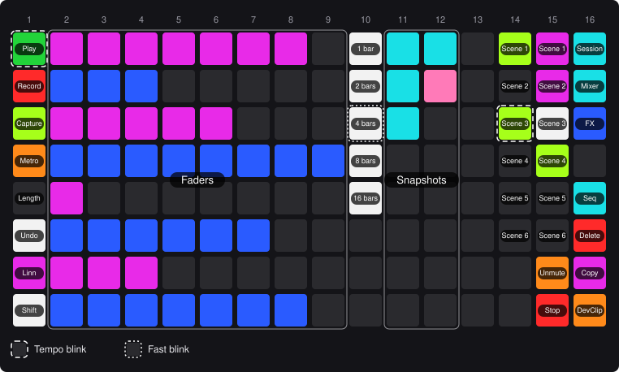

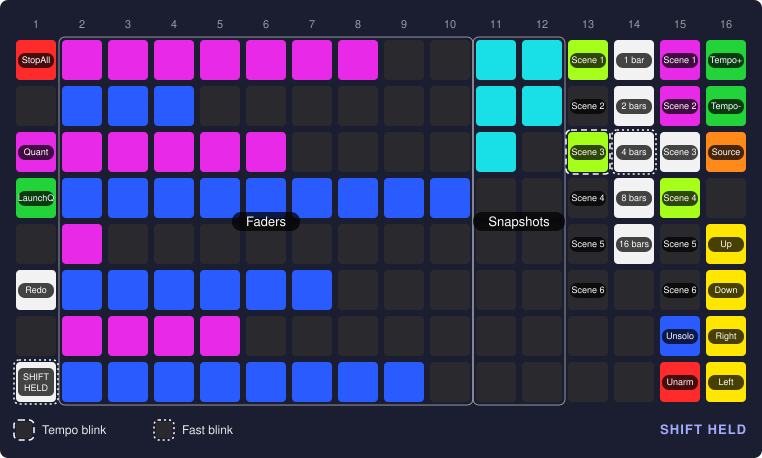

<!-- callouts:fx -->
- **Faders**: One fader per row: touch or slide along a row to set the selected device's macro or parameter.
- **Bars**: Hold one, then press a snapshot to morph to it over 1, 2, 4, 8 or 16 bars, or a scene to launch it on that bar line.
- **Snapshots**: Sixteen snapshots per bank of every rack's macros: slots 1–8 in column 11, 9–16 in column 12. Press an empty slot to store. Tap a stored one to recall it, or slide right from it to blend towards it. Shift + a slot binds the parameter clicked in Live to it, in pink.
- **Banks**: Eight banks of sixteen snapshots: press one to show its slots. The selected bank is orange. Every Set opens on bank 1.
- **Scene snapshots**: A snapshot per scene, scrolling with the scene pads. Press an empty one to store, a stored one to recall. Launching the scene morphs to it.
<!-- /callouts:fx -->

### Sequencer Mode

- Tap Seq to sequence Live's highlighted clip slot.
- In Session Mode, hold Seq and press a slot to highlight the clip and open the sequencer.
- The track is armed alone while you sequence it; Device/Clip + Track (+/-) steps to another. Leaving puts every arm back.
- The Global column works as in Linnstrument Mode: Record Clip, Capture MIDI, and with Shift held, Stop track, Session Record and the scene page on pad 7. Without Shift, pad 7 switches to Linnstrument Mode keeping the arm, and its Back returns here.
- **View** toggle (column 15, pad 8) switches columns 11–14 between the note pads tab and the sequence pages/settings tab.

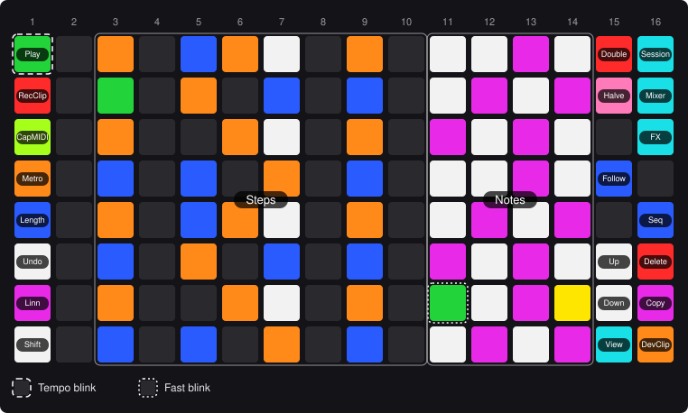

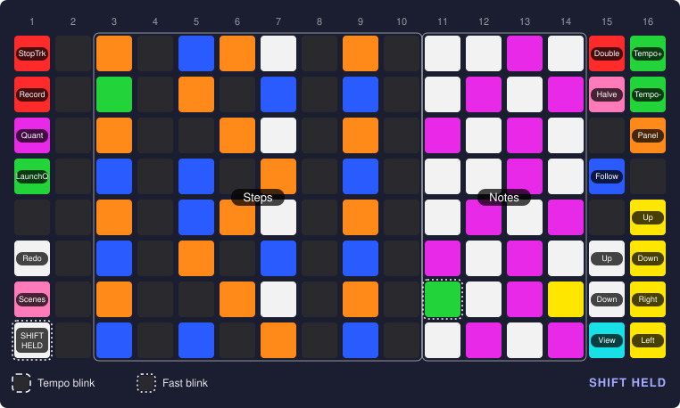

<!-- callouts:sequencer-functions -->
- **Steps**: 64 steps, top row first. Tap to add or remove the selected note. Hold a step and press a later one for one long note, or slide along the row to change its velocity.
- **Notes**: Choose the note the steps write: press a pad to select its note and hear it on the armed track. Hold steps and press a pad to add or remove that note on them.
- **Double**: Double the loop, notes and all.
- **Halve**: Halve the loop. Notes past the new end stay in the clip.
- **Follow**: Follow on/off: the steps show the page that's playing. Blue while on.
- **Up/Down**: Move the note pads an octave up or down.
- **View**: Switch columns 11–14 between the note pads and the settings.
- **Delete**: Hold, then press a step to clear it, or a note pad to remove that note from the clip.
- **Copy**: Hold, press a step, then press steps to paste it onto.
- **Press and hold a step**: Change the velocity by sliding left (lower) or right (higher).
- **Shift + press and hold a step**: Nudge the note forward or backward by sliding left and right.
<!-- /callouts:sequencer-functions -->

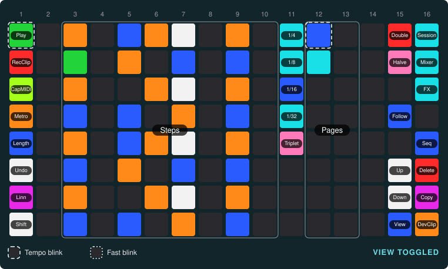

<!-- callouts:sequencer-settings -->
- **Rates**: The step length: 1/4, 1/8, 1/16 or 1/32. The current one is blue.
- **Triplet**: Triplet steps on/off: orange while on.
- **Pages**: Pages 1–16 of 64 steps: 1–8 in column 12, 9–16 in column 13. Press one to show it, or hold one and press another to loop both.
<!-- /callouts:sequencer-settings -->

### Linnstrument Mode

- Columns 2–16 and the panel buttons are your instrument again. The Global column keeps its controls, always opening on the controls page.
- Back (pad 7) returns to the mode you came from: Session, Mixer, FX or Sequencer.
- Shift + Record is Session Record, and Shift + Back opens the scene page.
- Changing a setting on the panel can save BleakLoop's control split as your own: read the warning under Using BleakLoop first.

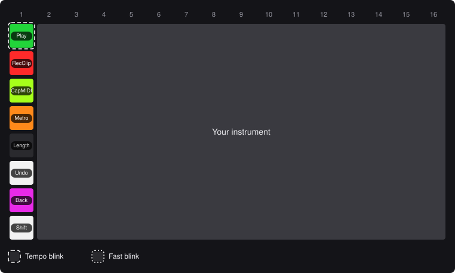

Only the Global column stays: on its controls page, with Shift held, and on the scene page.

<!-- callouts:linnstrument -->
- **Play**: Start/stop. Blinks on the beat while playing.
- **Record Clip**: Record a new clip on the selected track.
- **Capture MIDI**: Capture MIDI.
- **Metronome**: Metronome on/off. Blinks while on.
- **Fixed Length**: Record new clips at exactly 1, 2, 4 or 8 bars. Each press steps to the next length, then off.
- **Undo**: Undo.
- **Back**: Back to the mode you came from: Session, Mixer, FX or Sequencer.
- **Shift**: Hold for the Shift layer.

With **Shift** held:

- **Stop track**: Stop the selected track's clips.
- **Record**: Session Record on/off (Arrangement Record in Arrangement View). Blinks while recording.
- **Quantize**: Quantize the current MIDI clip to 1/16 notes.
- **Launch quantization**: Launch quantization on/off; red while off.
- **Redo**: Redo.
- **Scene page**: Show the scene page.
<!-- /callouts:linnstrument -->

On the scene page:

<!-- callouts:linnstrument-scenes -->
- **Scenes**: Launch a scene and its FX snapshot, and go back to the controls.
- **Back**: Back to the controls without launching.
<!-- /callouts:linnstrument-scenes -->

<br clear="right">

## 3. Using BleakLoop

### Moving around

**Session, Mixer and FX** (column 16, pads 1–3) pick the mode. The current one is blue, the others cyan. Press another mode's pad to switch straight to it. In FX Mode, FX goes back to Session Mode. In Session Mode, Session toggles the split view, and in Mixer Mode, Mixer toggles Mixer's; each is pink while its split view is on.

The reserved pad, pad 4, is dark and does nothing: it's kept for a Chord mode still to come. **Seq** (pad 5) opens Sequencer Mode, then come **Delete** (pad 6), **Copy** (pad 7) and **Device/Clip** (pad 8).

**Device/Clip** (column 16, pad 8, orange):

- A tap flips Live's Detail view: to Clip view if it shows anything else or is hidden, and to Device view if it shows Clip view. It follows what you last clicked in Live. A press counts as a tap only if you press nothing else while holding it.
- Held, like Shift, its pad blinks fast and column 16 shows the Device/Clip layer, over Shift's layer too. Columns 1 and 15 and the grid work as usual.
- It works in Session, Mixer, FX and Sequencer Mode. In Sequencer Mode, a track that isn't a MIDI track darkens the steps and note pads until you step on to one.
- Tracks steps through every track, then the returns and master. Devices are the ones directly on the track; with a device inside a rack selected, they step from that rack. The FX faders follow the selected device.
- The status bar shows the track or device stepped to, or "No more tracks" / "No more devices" at either end.
- With Shift's layer showing, its pad is Left, a window move, and never flips the view.

### Clips, scenes, copy and delete

A group track's slots show the clips of its member tracks, in the group's colour, so a folded group still shows what it holds. A slot is lit if any member has a clip in that scene, blinks while one plays, and turns yellow or red while one is about to launch or recording. Pressing it launches the scene's clips on every member track.

Recording on a MIDI track switches to Linnstrument Mode, so you can play straight away.

**Fixed Length** is one pad: its colour shows the length, dark while off, then cyan, blue, magenta and pink. The length stays when you change mode.

**Scenes** (column 15, pads 1–6) launch the window's scenes. A scene with an FX snapshot morphs the macros to it, landing as the scene starts. Shift + a scene launches it legato and leaves the macros alone, and so does a launch from Live's mouse or another controller. With a Bars pad held, in FX Mode or the split view's snapshots, a scene launches on that bar line instead (see Snapshots and morphs).

**Stop** (column 15, pad 8) is held like Copy and Delete. Hold it and press any pad in a track's column to stop that track's clips; a tap on its own does nothing. In FX Mode, holding Stop leaves the grid alone. Shift + Play stops all clips.

**Copying:**

- Clips copy MIDI to MIDI and audio to audio, into an empty slot.
- A group track's slot copies its members' clips to another row of the same group, as long as none of those members has a clip there.
- To copy a scene, press it, then press an empty scene.
- Keep holding Copy to make more copies.

**Deleting:** a group track's slot deletes its members' clips in that scene.

**Quantize** (Shift + Capture) works on the highlighted clip. If there isn't one, it uses the clip in Live's Detail view, then the selected track's playing clip.

### Arming, mute and solo

**Mute row** (pad 7): pink while the track is audible, orange while muted. With Shift held it shows solo instead: cyan, blue while soloed. Solo follows Live's Exclusive Solo preference: while it's on, soloing a track unsolos the others, as Live's own solo button does.

**Select and arm row** (pad 8):

- Press a track to select it and arm it. Every other track is disarmed, whatever Live's Exclusive Arm preference says.
- Pressing the selected, armed track leaves it armed. Disarm it with Shift, below.
- A track that can't be armed, such as a group track, is only selected.
- The blue hand moves to the track's first Instrument, Drum or Audio Effect Rack with a mapped macro, or its first such rack if none has one, so Device FX shows its macros. Only racks directly on the track count, and a track without one keeps Live's selection. Device/Clip + Tracks does the same.
- Hold Shift and press a track to arm or disarm it alone. The selection and the other tracks stay as they are, so you can arm several tracks.
- Red while armed, white while selected, lime otherwise. A track that can't be armed is dark unless it's selected.

With Exclusive Arm on, Live arms the selected MIDI track by itself. BleakLoop can't undo that, so after you disarm the selected MIDI track its pad may stay red.

**Unmute all** (column 15, pad 7) acts on every track and return track in the Set, not just the window. With Shift held it's **Unsolo all**.

**Unarm all** (Shift + Stop, column 15, pad 8) disarms every track in the Set, not just the window. It's red while any track is armed, and dark otherwise. With Exclusive Arm on, Live re-arms the selected MIDI track by itself, as above.

### Split view

- Session Mode and Mixer Mode each have their own split view, toggled by their own pad. Columns 2–9 work as in that mode for an 8-track window, and Live's ring shrinks to match. The window moves as usual; turning the split view off keeps it where it is, unless it then runs past the last track.
- Columns 10–14 are the panel, in every row. Shift + FX switches it between Device FX and the snapshots, and both split views show the same choice. It shows Device FX each time Live starts or a Set opens.
- As faders, five pads wide, they work as FX Mode's. They have no mute or arm pads.
- As snapshots, columns 10–14 work as FX Mode's: Bars, snapshots, banks and scene snapshots, with Copy and Delete as there. Both split views and FX Mode show the same bank.
- With Shift held the panel's faders work as without it, and its snapshot pads stay lit. Shift + a slot binds a parameter to it; the other snapshot pads ignore presses.
- A slide off either end of a fader doesn't press the clip, mute or arm pad in column 9, or the scene in column 15.
- The faders need the LinnStrument's slides, which change columns 2–9 a little: rolling a finger from one clip onto the next launches only the first, and two neighbouring clips pressed near their shared edge may launch only one.
- FX Mode always shows 13 tracks, and so do Session and Mixer Mode without their split view; near the last track, the window moves left to fill them. Each mode keeps its own split view on or off when you leave it.
- The split views are off, and the panel shows Device FX, each time Live starts or a Set opens.

### Mixer faders

- Pads 1–6 are the fader. Press a pad to set the volume: pad 1 is 0 dB, and each pad below it is a step quieter.
- Keep your finger down and slide to fine-tune, up to Live's maximum.
- Slide on to the next pad to keep going. A slide that runs off pad 6 stops there: it doesn't mute or arm the track. The other way round, a slide from pad 7 or 8 onto the fader doesn't move it.
- One slide is one undo.
- Pads 7 and 8 mute and arm the track as in Session Mode, Shift layer included.
- Hold Stop and press any of a track's pads to stop its clips.
- Copy and Delete do nothing here.

### FX faders

**Faders** (columns 2–9): one fader per row, **Device FX**, for the device with Live's blue hand. Clicking a device in Live, or Device/Clip + Devices, moves the blue hand there; so does another controller's device navigation. Selecting a track with pad 8 or Device/Clip + Tracks moves it to the track's first rack (see Select and arm row).

- A rack's rows are its macros 1–8; any other device's are its first eight parameters. Rows past the last parameter are dark, and with no device selected every row is dark.
- Touch a row and the value jumps to your finger: the centre of column 2 is the minimum, the centre of column 9 the maximum. Slide along the row to move it.
- The lit pads, counted from the left, show the value. Rows alternate magenta and blue so you can count them. The bar follows the parameter, so automation, a morph or a turn of the knob in Live move it too.
- Slide past either end and the value stays at that end. Your finger can go on over the Global column, Bars or the snapshots without pressing them, until you lift it.
- One touch is one undo, however many rows you move at once.
- A fader on a macro that's morphing takes that macro out of the morph; the rest of the morph carries on. On a macro a held snapshot slide is moving, it takes it out of the slide the same way, and its moves join the slide's undo.
- Holding Stop or Copy, a fader does nothing. Holding Shift, it works as without it.

To put any parameter of the Set on a pad, bind it to a snapshot slot (see Bound snapshots).

### Snapshots and morphs

**Snapshots:**

- A snapshot holds the visible macros of every rack on the Set's tracks, groups, returns and master. Racks inside other racks aren't included.
- Press an empty (dark) slot to store a snapshot. Hold Copy and press any slot to store over it, except a bound (pink) one: that re-saves its punch-in values (see Bound snapshots).
- Tap a stored (cyan) slot to recall it at once. The recall happens as you lift your finger: until then the slot can't tell a tap from a slide.
- Hold a Bars pad, then press a stored slot to morph to it. This one starts on the press. The macros start moving at once and land exactly on a bar line: pressed at bar 1 beat 2 with 4 bars held, the morph lands at bar 5. On/off and chooser macros switch when the morph lands.
- While the transport is stopped, a recall always happens at once.
- Hold Delete and press a stored slot to clear it.
- A rack is found again by its track's name, its own name and its order among racks with both names. A rack that has been renamed or deleted is skipped, with a message.
- Snapshots 1–8 in column 11, 9–16 in column 12.

**Banks** (column 13, pads 1–8):

- There are eight banks of sixteen snapshots, 128 in all. The slots show the selected bank; press a bank pad to switch. The selected bank is orange, the others dark.
- Every Set opens on bank 1, as does Live starting: the selected bank isn't saved, so switching banks never adds a step to Live's Undo.
- Past bank 1 the status bar names the bank too, such as "Snapshot 3, bank 2 recalled".
- A morph and the last-landed blink belong to their slot's bank: switch away and the morph carries on, but its slot blinks only while its bank shows.

**Slides:**

- Press a stored slot and slide right: the macros blend from where they were towards the snapshot. Four pads of travel is 100%, so a slot in column 11 reaches it at column 15, and one in column 12 at column 16. Sliding back left blends back, down to 0%.
- A quarter of a pad's movement either way makes it a slide; less is still a tap. A slide never recalls on the lift.
- A slide moves each macro smoothly. Where an on/off or chooser mapped to it switches is up to that mapping in Live, so set it there, for example to bring an effect on at the first move.
- Lift your finger and the macros stay where the slide left them, even at 0%. The status bar says how far it got, such as "Snapshot 3 at 60%".
- While you slide, the four pads from the slot to its 100% pad fill in the slot's colour, one per 25%, over whatever they normally show, and the slot blinks fast. Nothing your finger crosses is pressed: not the other slots, banks, scene snapshots, scenes or Navigation, and not Bars or column 11's slots on the way back.
- A Set-wide (cyan) slot slides every rack it holds towards the snapshot. A bound (pink) slot slides both ways instead (see Bound snapshots).
- Slide several slots at once, one per row; a second slot pressed on a row that's already holding one does nothing. Where two slides share a macro, the one started last moves it. Lift it and the macro goes back to the earlier slide, at that slide's position; lift the earlier one first and nothing moves.
- A fader, or a turn of the knob in Live, on a macro that's sliding takes it out of every slide. Tapping another slot, or starting a Bars morph, while you slide does the same for the macros it moves.
- A slide's first move stops a running morph. Holding Bars, a press morphs instead of sliding, and scene snapshots don't slide.
- One slide is one undo, from its first move to its lift. Slides held at the same time, and any tap, morph or fader you use during them, share it.

**Bound snapshots:**

- A slot can hold parameters of your choice instead of a snapshot: a bound slot, pink. Sliding it moves its parameters from wherever they are, not to stored values.
- Binding a parameter saves its value at that moment as the slot's punch-in value for it. Binding a second parameter saves that one's value and leaves the others' alone.
- To bind, click a parameter in Live, then hold Shift and tap the slot: it acts as you lift. Or, in FX Mode, hold Shift and the slot and tap a Device FX row: that row's parameter is bound instead.
- Any parameter of a device directly on a track, group, return or master can be bound, and so can a track's volume, pan and sends; a slot can hold several, from different tracks and devices. A parameter inside a rack's chain can't: map it to one of the rack's macros, and bind the macro.
- Binding a parameter the slot already holds removes it, with its punch-in value. Removing the last one empties the slot. The status bar names what the slot holds after a bind, the new parameter last with its saved value, such as "Snapshot 3: Macro 2, Auto Filter Frequency 1.20 kHz", or what was removed, such as "Removed Auto Filter Frequency from Snapshot 3".
- With nothing clicked in Live, the status bar says "Click a parameter in Live first". A Set-wide (cyan) slot refuses with "Delete Snapshot N to bind to it". A parameter that can't be bound says "Snapshot N can't hold" and its name. A Device FX row with no parameter does nothing.
- With Shift held, a slot never recalls, stores or slides.
- Slide a bound slot right to raise its parameters, left to lower them, below where they started too. Every pad moves each parameter by a quarter of its range, and it stops at its minimum or maximum. Sliding back returns exactly to where it started. On/off and chooser parameters step to the nearest value: an on/off flips at 2 pads either way, and a chooser steps through its options in order as you slide. To switch somewhere else, map it to a rack macro, set that mapping in Live, and bind the macro.
- While you hold a bound slot, the 4 pads to its right show where its parameters sit on average, in pink: none lit with all at their minimum, all 4 with all at their maximum. They follow the slide, over whatever those pads normally show.
- A tap changes nothing: the status bar names the slot's parameters, their values now and their punch-in values, such as "Snapshot 3: Frequency 1.20 kHz → 3.40 kHz, Macro 2 0.5" (Macro 2 has no punch-in value). A Bars pad doesn't morph a bound slot. Lists of a slot's parameters give their names only, adding the device's or track's name where two share a name, such as "Auto Filter Frequency, EQ Frequency, Volume". When a list is too long for the status bar it ends with "+N" for the rest.
- A rack macro is found again by its rack and its number, so renaming or mapping the macro doesn't lose it. Anything else is found by the track's, device's and parameter's names, counting same-named tracks and devices in order; one that can't be found is skipped, with a message.
- Delete + a bound slot clears it; press the empty slot to store a Set-wide snapshot there.
- Copy + a bound slot saves its parameters' values now as their punch-in values, and the slot stays bound, such as "Snapshot 3 punch values: Frequency 3.40 kHz". A parameter that can't be found keeps its old value.
- **Undo:** within 10 seconds of a bind or a removal, with nothing else pressed since, the Undo pad (column 1, pad 6) reverses it, newest first, saying "Unbound …" or "Bound … again"; a parameter bound again gets its punch-in value back. Each reversal gives you another 10 seconds. After that, or once you've pressed anything else, the pad is Live's Undo again. Live's own Undo (Cmd-Z) never touches binds. Shift doesn't end the window, but let go of it first: Shift + Undo is Redo.
- Pink slots from older versions, which held one rack's macros, load as that rack's macros bound, without their stored values. They, and slots bound before punch-in values existed, have no punch-in values until you Copy onto them.
- Scene snapshots can't be bound.

**Scene snapshots** (column 14, pads 1–6):

- Each scene can hold one snapshot. Pad N is the snapshot of the scene on column 15's pad N, so the column scrolls with the window. Pads past the last scene, and pads 7 and 8, are dark.
- Store, recall, morph with a Bars pad, store over with Copy and clear with Delete as with the snapshots above. Pressing one never launches its scene.
- A stored scene snapshot is lime. It blinks fast while it is the morph's target, and with the beat when it was the last snapshot to land. Only one snapshot blinks as the last to land, scene or not. A bound slot never does.
- Launching the scene from column 15, or from Linnstrument Mode's scene page, morphs the macros to its snapshot. The morph starts at the press and lands exactly as the scene starts, on the next launch quantization boundary: with 1 Bar, pressed at bar 3 beat 2, it lands at bar 4. With launch quantization None, or the transport stopped, it recalls at once. With a Bars pad held, it lands as the timed launch below starts the scene.
- Shift + a scene (legato) doesn't fire the snapshot, and neither do launches from Live's mouse or another controller. A scene without a snapshot leaves the macros, and any running morph, alone.
- The snapshots follow Live's scenes. Move a scene and its snapshot moves with it; delete a scene and its snapshot goes; a new scene starts empty.
- Live's Duplicate copies the scene's snapshot to the copy. So does any new scene inserted straight below a scene with a snapshot, when it has the same clips on the same tracks and at least one clip, such as Capture and Insert Scene. Copy + scene copies the snapshot too; if the source has none, the target keeps its own.
- Undoing a scene delete in Live brings the scene back without its snapshot.

**Timed scene launches:**

- Hold a Bars pad, in FX Mode or the split view's snapshots, and press a scene in column 15: the scene starts on that bar line, as a morph lands: pressed at bar 1 beat 2 with 4 bars held, it starts at bar 5. If launch quantization doesn't fall on that bar line, such as 4 Bars with 1 bar held, it starts on the first quantization boundary after it.
- Its scene snapshot, if it has one, morphs from the press and lands as the scene starts.
- The scene pad blinks yellow with the beat until BleakLoop fires the scene, then blinks lime as usual until it starts.
- With the transport stopped, the scene launches at once.
- Stopping the transport, or jumping back in the song, cancels a waiting launch, with a message. Live's Arrangement loop coming round isn't a jump: the launch keeps counting its bars.
- A new scene press replaces a waiting launch; the replaced launch's morph still lands at its bar line. Shift + a scene launches it legato at once, whatever Bars pad is held.

**During a morph:**

- Its slot blinks fast. The last Set-wide slot to land blinks with the beat.
- A new recall takes over from where the macros are.
- A macro you turn yourself drops out of the morph and keeps your value.
- Stopping the transport, or jumping back in the song, lands the morph at once.
- Live's Arrangement loop coming round isn't a jump: the morph keeps going until it has played its bars, even when it's longer than the loop. Once the loop has come round, a scene's snapshot lands as Live actually starts the scene.
- The morph carries on when you leave FX Mode.

A recall or a slide overrides any automation on the macros, as turning the knob would: Live's Re-Enable Automation button lights up. A morph starts from wherever the automation has each macro. A recall is one undo, and so is a whole morph. Undo doesn't bring back a stored or cleared snapshot: store it again, or clear it again.

### Sequencer

Sequencer Mode is a 64-step sequencer on a MIDI clip, with note pads to pick and hear notes. It works on Live's highlighted clip slot, and follows it when you click another slot in Live.

**Opening it** with Seq (column 16, pad 5), which is cyan in Session, Mixer and FX Mode:

- Tap Seq to open Sequencer Mode on the highlighted slot. If that slot is empty, it moves first to the clip in Live's Detail view, if that's a Session clip on a MIDI track, or else to the selected track's playing clip.
- In Session Mode, hold Seq (it blinks fast) and press a clip slot to open Sequencer Mode on that slot. The clip doesn't launch, and an empty slot works too. In Mixer and FX Mode the grid ignores presses while Seq is held.
- On an audio or group track, Seq says "Sequencer needs a MIDI track".
- In Sequencer Mode, Seq or Session goes back to Session Mode, and Mixer or FX to that mode.

**The arm.** Opening Sequencer Mode arms the track alone, so the note pads play it. Selecting another MIDI track, with Device/Clip + Tracks or by clicking it in Live, moves the arm with it. Leaving for Session, Mixer or FX puts every track's arm back as it was, except a track you armed or disarmed yourself in the meantime, and so does closing the Set or Live while in Sequencer Mode. Linnstrument Mode (column 1, pad 7) keeps the arm, so you play the track you were sequencing, and its Back returns to Sequencer Mode. Selecting an audio track, a return or master leaves the arm where it is, and the steps and note pads go dark.

**An empty slot** gets a new MIDI clip when you add its first note, Fixed Length long, or 1 bar while Fixed Length is off.

**Steps** (columns 3–10): 64 steps, row by row from the top, of the page in view.

- A step is orange if the selected note starts in it, blue if it only holds other notes, and dark if it's empty. The playhead is white. Steps past the loop end are dark and do nothing.
- Tap a step to add a one-step note of the selected note, at the strength you struck the pad. Tap it again to remove it. The tap acts when you lift your finger.
- Hold a step and press a later one for one note spanning both. It replaces the selected note's notes between them.
- Hold steps and press a note pad to add or remove that note on each of them, at the strength you struck the note pad.
- A note belongs to the step it starts nearest: a note that starts past a step's midpoint belongs to the next step.
- Each edit is one undo.

**Slides.** Hold a step and slide your finger along its row:

- **Velocity:** slide right to raise the velocity of every note on the step, left to lower it, by about 16 per column, between 1 and 127. While you slide, the row is a meter of the velocity, orange for the selected note, or blue for the step's loudest note when the selected note isn't there.
- **Nudge:** hold Shift as you press the step, then slide: each column moves its notes by an eighth of a step, later to the right, earlier to the left, never before the clip's start. A note nudged past the step's midpoint belongs to the next step, and its light moves there.
- A slide starts once your finger has moved a quarter of a column. Until then, the hold works as a tap or as the start of a span. An empty step doesn't slide.
- Your finger can slide over other pads without pressing them, until you lift it. Sliding onto the note pads doesn't sound them.
- A slide is one undo, however far it goes. Other edits wait until you lift your finger.

**Note pads** (columns 11–14): 32 notes, chromatic, with each row 4 semitones above the one below. C2 is at the bottom left.

- Naturals are white, sharps and flats magenta. With Live's Scale Mode on, the root is cyan, the scale's other notes white, and the rest magenta. Every pad still plays.
- Press a note pad to select it and hear it on the armed track, at the strength you struck it. The selected note blinks green, and a note playing in the clip lights yellow.
- While you hold a step, the note pads in its row are silent, so a slide can cross them. Holding a step and pressing a note pad in another row still lets you hear the note.

**On a Drum Rack** track, the note pads are the rack's pads, kept in step with Live's rack view:

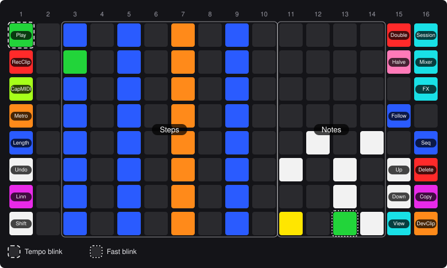

- Pads 5–8 (the near half) are the 16 pads Live's rack view shows, laid out as Live lays them out, and pads 1–4 the 16 above them. Pads with a sound are white in the near half and cyan in the far half; empty pads are dark but still play and select.
- Up and Down scroll the rack a row of 4 at a time, and Live's rack view scrolls with them. Scrolling in Live moves the pads too.
- Pressing a pad selects that drum pad in Live, and the steps edit it. Selecting a pad in Live does the same.
- The rack is the track's first Drum Rack, also inside an Instrument Rack or another rack: BleakLoop looks through the track's devices in order, and through each rack's chains in order.

**Copy and Delete:**

- Hold Copy and press a step: it blinks red. Then press other steps to paste it. A paste replaces what the step holds with the copied notes, each with its pitch, velocity, length and position in the step. Keep holding Copy to paste again, on any page. An empty step can't be copied.
- Hold Delete and press a step to clear it, or a note pad to remove that note from the whole clip.

**Settings.** View (column 15, pad 8) switches columns 11–14 between the note pads and the settings. It's blue while the settings show. Up (pad 6) and Down (pad 7) move the note pads an octave in either view.

- A new rate changes how long a step is, not the notes: they stay where they are, and the steps redraw. The rate and Triplet stay while Live runs.
- Each page is 64 steps. The page in view is blue, pages starting before the loop end are cyan, and pages past it are dark. The page that's playing blinks with the beat.
- **Follow** (column 15, pad 4) is on whenever Sequencer Mode opens or moves to another track: the steps show the page that's playing, or page 1 while the clip is stopped. Pressing a page shows it and turns Follow off; pressing the playing page turns it back on.
- Press a dark page past the loop end to extend the loop to the end of that page. Hold one page and press another to loop from the start of the first to the end of the last.
- **Double** doubles the loop, copying its notes into the new half. **Halve** halves it, as long as it stays at least a step long.

### Linnstrument Mode

The LinnStrument is your instrument again. The Global column keeps the controls it has in Session Mode, so the pads are where you know them. You're playing the selected track, so Record records a new clip on it, Capture captures MIDI to it, and Shift + Play stops its clips. The Global column always opens on the controls page. **Back** (pad 7) returns to the mode you came from: Session, Mixer, FX or Sequencer.

> **Careful:** in Linnstrument Mode the LinnStrument's own panel buttons work again. Changing a setting there (Octave, Volume, Per-Split, Split and the like) saves BleakLoop's control split as your own, along with any MPE channel it borrowed. To undo that, close Live and set your split up again on the device. If you change the left split's Octave or Transpose, BleakLoop puts them back, so select the right split first. Each Global column press first checks the device's Row Offset, so a press right after a Row Offset change never fires the wrong control. It is ignored while BleakLoop catches up, within about a second, or two for a custom offset or a guitar tuning. Guitar tuning edits are still only picked up by that catch-up. A Row Offset that repeats notes in the Global column (zero offset, or a guitar tuning with repeated strings) turns its controls off, with a message. If you move the right split onto the Global column's channel, BleakLoop moves the Global column to a free channel, with a message. If the right split uses every channel, the Global column's controls go off until one is free again.

**Record Clip** needs an armed track. It records into the next empty slot down from the highlighted scene, and adds a scene if there's none. Fixed Length applies.

**With Shift held**, Shift + Record is Session Record, and Shift + Back opens the scene page.

**The scene page** shows the window's 6 scenes on pads 1–6. Press a scene to launch it, along with its FX snapshot, or press Shift again to go back without launching.

### Reading the lights

- **Tempo blink** (dashed ring): on the beat while playing, and at the Set's tempo while stopped.
- **Fast blink** (dotted ring): something held or chosen.
- **Track colours** use the closest LinnStrument colour.
- **Clip slots:** track colour, blinking while playing; track colour, has a clip; yellow, about to launch; red, recording; white, empty and ready to record.
<!-- lights:scenes -->
- **Scenes:** yellow and blinking with the beat while a held Bars pad holds their launch back to its bar line; lime and blinking fast once launched, until they start at the next quantization boundary; lime while all their clips play; magenta while some of their clips play; white if they hold clips.
<!-- /lights:scenes -->
- **Sequencer Mode** has its own colours: orange steps hold the selected note, blue steps other notes, and the playhead is white. A note pad lights yellow while its note plays, and the selected note blinks green.
- On the LinnStrument, lime looks yellow and green looks lime.
