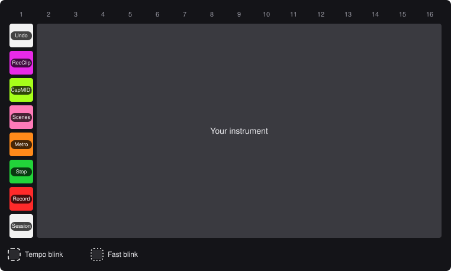
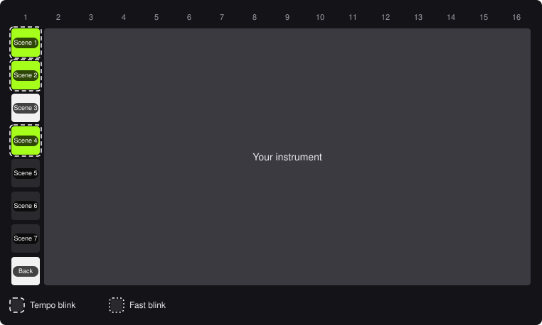

# BleakLoop player's manual

BleakLoop turns a LinnStrument 128 into a clip launcher, mixer and transport for Ableton Live 12. One pad hands the surface back to you as an instrument.

> **Heads-up:** if a press seems to do nothing, look at Live's status bar. When BleakLoop refuses something, it says why there.

## 1. Setup

1. Copy the `src/BleakLoop/` folder into Live's Remote Scripts folder.
2. In Live's Control Surface preferences, choose **BleakLoop**, with the LinnStrument as Input and Output.

BleakLoop starts in Session Mode. Its Note Mode controls use MIDI channel 1.

While Live runs, BleakLoop turns the LinnStrument's split on and makes column 1 its control split. When Live closes, or you choose another control surface, it puts your own split settings back.

## 2. Finding your way

- Columns are numbered 1–16 from the left, pads 1–8 from the far edge.
- Columns 2–14, pads 1–7, show a 13-track by 7-scene window onto Live's session. Live draws a ring around it.
- Shift, Copy and Delete work while held.
- Each map shows the pads' names over their colours in an example Set. A dashed ring blinks with the beat; a dotted ring blinks fast.

## 3. Session Mode

<!-- callouts:session -->
- **Clip slots**: Launch a clip. On an armed track, an empty slot records. *(Shift: Launch with legato)*
- **Track switches**: Mute, solo or arm the track, as set by the track switch mode. *(Shift: Stop the track's clips, in Mute mode)*
<!-- /callouts:session -->

**Clip colours:**

- Track colour, blinking: playing.
- Track colour: has a clip.
- Yellow: about to launch.
- Red: recording.
- White: empty, ready to record.

Recording on a MIDI track switches to Note Mode, so you can play straight away.

**Track switch colours:**

- Mute: orange while audible, lime while muted.
- Solo: blue while soloed, lime otherwise.
- Arm: red while armed, lime otherwise. Arming a track disarms the others.

## 4. Side columns

Columns 1, 15 and 16 work the same in Session and Mixer Mode.

<!-- callouts:side -->
- **Undo**: Undo. *(Shift: Redo)*
- **Copy**: Hold, press a clip, then an empty slot.
- **Capture**: Capture and Insert Scene. *(Shift: Quantize the current MIDI clip to 1/16 notes)*
- **Delete**: Hold, then press a clip or scene to delete it.
- **Metronome**: Metronome on/off. Blinks while on. *(Shift: Launch quantization on/off; red while off)*
- **Play**: Start/stop. Blinks on the beat while playing.
- **Record**: Session Record on/off (Arrangement Record in Arrangement View). Blinks while recording.
- **Note Mode**: Switch to Note Mode.
- **Fixed Length**: Record new clips at exactly 1, 2, 4 or 8 bars. Press again to clear. *(Shift: Move the window up, down, left or right)*
- **Mixer**: Mixer Mode on/off. Blinks while on. *(Shift: Stop all clips)*
- **Track switch mode**: What the track switches do: Mute, Solo or Arm. The chosen one blinks. *(Shift: Tempo +1 BPM on Solo, -1 BPM on Arm)*
- **Scenes**: Launch a scene. *(Shift: Launch with legato)*
- **Shift**: Hold for the Shift layer.
<!-- /callouts:side -->

**Copying:**

- Clips copy MIDI to MIDI and audio to audio, into an empty slot.
- To copy a scene, press it, then press an empty scene.
- Keep holding Copy to make more copies.

**Scenes** are lime and blinking while playing, and white if they hold clips.

## 5. Shift

Hold Shift for a second layer. The lists above give each pad's Shift function in italics. Unlit pads do nothing, and in Mixer Mode the faders go dark.

**Quantize** works on the highlighted clip. If there isn't one, it uses the clip in Live's Detail view, then the selected track's playing clip.

## 6. Mixer Mode

<!-- callouts:mixer -->
- **Faders**: One volume fader per track.
<!-- /callouts:mixer -->

- Press a pad to set the volume: pad 1 is 0 dB, and each pad below it is a step quieter.
- Keep your finger down and slide to fine-tune, up to Live's maximum.
- Slide on to the next pad to keep going.
- One slide is one undo.
- Copy and Delete do nothing here.

## 7. Note Mode

The LinnStrument is your instrument again. Column 1 holds BleakLoop's controls and always opens on the controls page.

> **Careful:** in Note Mode the LinnStrument's own panel buttons work again. Changing a setting there (Octave, Volume, Per-Split, Split and the like) saves BleakLoop's control split as your own. To undo that, close Live and set your split up again on the device.

### Controls page

<!-- callouts:note -->
- **Undo**: Undo.
- **Record Clip**: Record a new clip on the selected track.
- **Capture MIDI**: Capture MIDI.
- **Scene page**: Show the scene page.
- **Metronome**: Metronome on/off. Blinks while on.
- **Stop**: Stop the selected track's clips. In Arrangement View: start/stop.
- **Record**: Session Record on/off (Arrangement Record in Arrangement View). Blinks while recording.
- **Session Mode**: Back to Session Mode.
<!-- /callouts:note -->

**Record Clip** needs an armed track. It records into the next empty slot down from the highlighted scene, and adds a scene if there's none. Fixed Length applies.

### Scene page

<!-- callouts:note-scenes -->
- **Scenes**: Launch a scene and go back to the controls.
- **Back**: Back to the controls.
<!-- /callouts:note-scenes -->

## 8. Lights

- **Tempo blink** (dashed ring): on the beat while playing, and at the Set's tempo while stopped.
- **Fast blink** (dotted ring): something held or chosen.
- **Track colours** use the closest LinnStrument colour.
- On the LinnStrument, lime looks yellow and green looks lime.
