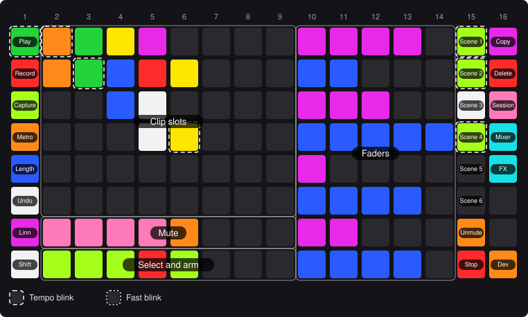
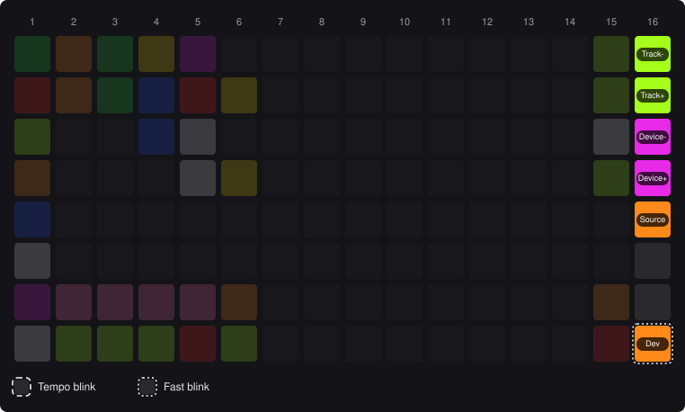
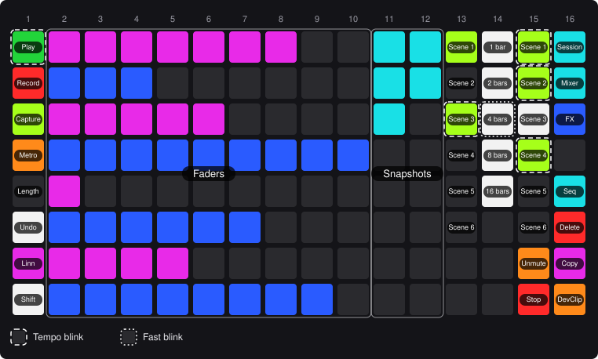
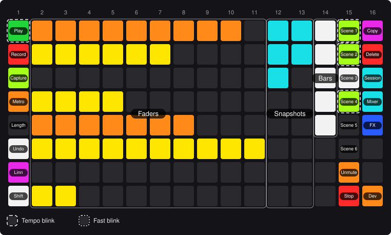

# BleakLoop player's manual

BleakLoop turns a LinnStrument 128 into a clip launcher, mixer and transport for Ableton Live 12. One pad hands the surface back to you as an instrument.

> **Heads-up:** if a press seems to do nothing, look at Live's status bar. When BleakLoop refuses something, it says why there.

## 1. Setup

1. Copy the `src/BleakLoop/` folder into Live's Remote Scripts folder.
2. In Live's Control Surface preferences, choose **BleakLoop**, with the LinnStrument as Input and Output.

While BleakLoop loads, a rainbow rolls across the pads for about 3 seconds, and the pads don't play. Then BleakLoop starts in Session Mode. Its Linnstrument Mode controls use a MIDI channel that your right split doesn't use. Only if your right split uses all 16 does BleakLoop borrow one of its MPE channels, and it gives it back when Live closes.

While Live runs, BleakLoop turns the LinnStrument's split on and makes column 1 its control split. When Live closes, or you choose another control surface, it puts your own split settings back.

## 2. Finding your way

- Columns are numbered 1–16 from the left, pads 1–8 from the far edge.
- Columns 2–14, pads 1–6, show a 13-track by 6-scene window onto Live's session. Live draws a ring around it. Pads 7 and 8 of each column mute and arm that track. The split view (section 3) narrows the window to 8 tracks.
- Shift, Copy, Delete and Dev work while held.
- Each map shows the pads' names over their colours in an example Set. A dashed ring blinks with the beat; a dotted ring blinks fast.

## 3. Session Mode

<!-- callouts:session -->
- **Clip slots**: Launch a clip. On an armed track, an empty slot records. *(Shift: Launch with legato)*
- **Mute**: Mute or unmute the track: pink while audible, orange while muted. *(Shift: Solo or unsolo the track, as Live's Exclusive Solo preference says: cyan, blue while soloed)*
- **Select and arm**: Select the track and arm it alone. Press the selected, armed track to disarm it. *(Shift: Arm or disarm the track alone, keeping the selection)*
<!-- /callouts:session -->

**Clip colours:**

- Track colour, blinking: playing.
- Track colour: has a clip.
- Yellow: about to launch.
- Red: recording.
- White: empty, ready to record.

A group track's slots show the clips of its member tracks, in the group's colour, so a folded group still shows what it holds. A slot is lit if any member has a clip in that scene, blinks while one plays, and turns yellow or red while one is about to launch or recording. Pressing it launches the scene's clips on every member track.

Recording on a MIDI track switches to Linnstrument Mode, so you can play straight away.

**Mute row** (pad 7): pink while the track is audible, orange while muted. With Shift held it shows solo instead: cyan, blue while soloed. Solo follows Live's Exclusive Solo preference: while it's on, soloing a track unsolos the others, as Live's own solo button does.

**Select and arm row** (pad 8):

- Press a track to select it and arm it. Every other track is disarmed, whatever Live's Exclusive Arm preference says.
- Press the selected, armed track to disarm it. It stays selected.
- A track that can't be armed, such as a group track, is only selected.
- Hold Shift and press a track to arm or disarm it alone. The selection and the other tracks stay as they are, so you can arm several tracks.
- Red while armed, white while selected, lime otherwise. A track that can't be armed is dark unless it's selected.

With Exclusive Arm on, Live arms the selected MIDI track by itself. BleakLoop can't undo that, so after you disarm the selected MIDI track its pad may stay red.

### Split view

The split view shows 8 tracks and eight faders side by side. Press Session (column 16, pad 3) while in Session Mode to turn it on or off, with a message. Session is pink while the split view is on.

<!-- callouts:split -->
- **Clip slots**: Launch a clip. On an armed track, an empty slot records. *(Shift: Launch with legato)*
- **Mute**: Mute or unmute the track: pink while audible, orange while muted. *(Shift: Solo or unsolo the track, as Live's Exclusive Solo preference says: cyan, blue while soloed)*
- **Select and arm**: Select the track and arm it alone. Press the selected, armed track to disarm it. *(Shift: Arm or disarm the track alone, keeping the selection)*
- **Faders**: One fader per row, as in FX Mode, from the source Dev + Fader source picks.
<!-- /callouts:split -->

- Columns 2–9 work as in Session Mode for an 8-track window, and Live's ring shrinks to match. The window moves as usual; turning the split view off keeps it where it is, unless it then runs past the last track.
- Columns 10–14 are the faders, five pads wide, in every row: they work as FX Mode's (section 7), Device FX or Mapped FX. They have no mute or arm pads.
- A slide off either end of a fader doesn't press the clip, mute or arm pad in column 9, or the scene in column 15.
- The faders need the LinnStrument's slides, which change columns 2–9 a little: rolling a finger from one clip onto the next launches only the first, and two neighbouring clips pressed near their shared edge may launch only one.
- Mixer and FX Mode always show 13 tracks; near the last track, the window moves left to fill them. Pressing Session from them returns to whichever view you were in.
- The split view is off each time Live starts or a Set opens.

## 4. Side columns

Columns 1, 15 and 16 work the same in Session, Mixer and FX Mode. Column 1 is also the same in Linnstrument Mode (section 8), where Record, Capture and Shift + Play act on the selected track. Column 16, on the outer edge, holds Copy, Delete and the mode pads in every mode, and column 15, next to the grid, holds the scenes.

**Fixed Length** is one pad: its colour shows the length, dark while off, then cyan, blue, magenta and pink. The length stays when you change mode.

**Session, Mixer and FX** (column 16, pads 3–5) pick the mode. The current one is blue, the others cyan. Press another mode's pad to switch straight to it, or the current one's to go back to Session Mode. In Session Mode, Session toggles the split view (section 3), and is pink while it's on.

Pads 6 and 7 of column 16 are dark and do nothing: they're kept for Chord and Sequencer modes still to come. Pad 8 is **Dev** (below).

**Unmute all** (column 15, pad 7) acts on every track and return track in the Set, not just the window. With Shift held it's **Unsolo all**.

**Stop** (column 15, pad 8) is held like Copy and Delete. Hold it and press any pad in a track's column to stop that track's clips; a tap on its own does nothing. Shift + Stop stops all clips. In FX Mode, holding Stop leaves the grid alone.

<!-- callouts:side -->
- **Play**: Start/stop. Blinks on the beat while playing. *(Shift: Stop all clips. In Linnstrument Mode, stops the selected track's clips)*
- **Record**: Session Record on/off (Arrangement Record in Arrangement View). Blinks while recording. In Linnstrument Mode, records a new clip on the selected track.
- **Capture**: Capture and Insert Scene. In Linnstrument Mode, captures MIDI. *(Shift: Quantize the current MIDI clip to 1/16 notes)*
- **Metronome**: Metronome on/off. Blinks while on. *(Shift: Launch quantization on/off; red while off)*
- **Fixed Length**: Record new clips at exactly 1, 2, 4 or 8 bars. Each press steps to the next length, then off.
- **Undo**: Undo. *(Shift: Redo)*
- **Linnstrument Mode**: Switch to Linnstrument Mode.
- **Shift**: Hold for the Shift layer.
- **Scenes**: Launch a scene. *(Shift: Launch with legato)*
- **Unmute all**: Unmute every track and return track in the Set. Orange while any is muted. *(Shift: Unsolo every track and return track in the Set. Blue while any is soloed)*
- **Stop**: Hold, then press a track's pad to stop that track's clips. *(Shift: Stop all clips)*
- **Copy**: Hold, press a clip, then an empty slot. *(Shift: Move the window up)*
- **Delete**: Hold, then press a clip or scene to delete it. *(Shift: Move the window down)*
- **Session**: Session Mode. In Session Mode, toggles the split view. *(Shift: Move the window left)*
- **Mixer**: Mixer Mode. Press again for Session Mode. *(Shift: Move the window right)*
- **FX**: FX Mode. Press again for Session Mode.
- **Dev**: Hold for the Dev layer: tracks, devices and the fader source. *(Shift: Tempo +1 or -1 BPM)*
<!-- /callouts:side -->

**Copying:**

- Clips copy MIDI to MIDI and audio to audio, into an empty slot.
- A group track's slot copies its members' clips to another row of the same group, as long as none of those members has a clip there.
- To copy a scene, press it, then press an empty scene.
- Keep holding Copy to make more copies.

**Deleting:** a group track's slot deletes its members' clips in that scene.

**Scenes** are lime and blinking while playing, steady lime once launched until they start at the next quantization boundary, and white if they hold clips.

### Dev

Dev (column 16, pad 8, orange) is held, like Shift. While you hold it, its pad blinks fast and column 16 shows the Dev layer, over Shift's layer too. Columns 1 and 15 and the grid work as usual. Dev works in Session, Mixer and FX Mode.

<!-- callouts:dev -->
- **Tracks**: Select the previous or next track, through the returns and master.
- **Devices**: Select the previous or next device on the selected track.
- **Fader source**: Switch the faders between Device FX and Mapped FX.
- **Dev**: Held.
<!-- /callouts:dev -->

- The status bar shows the track or device stepped to, or "No more tracks" / "No more devices" at either end.
- Devices are the ones directly on the track. With a device inside a rack selected, they step from that rack. The FX faders follow the selected device.
- The fader source starts on Device FX each time Live starts or a Set opens.
- With Shift's layer showing, Dev's pad is Tempo −1, as before.

## 5. Shift

Shift is pad 8 of column 1, nearest you, and works in every mode. Hold it for a second layer. The lists above give each pad's Shift function in italics: Shift + Undo is Redo, Shift + Play stops all clips, column 16's top four pads move the window, and its bottom two step the tempo by 1 BPM. Unlit pads do nothing. In Mixer Mode the faders go dark and pads 7 and 8 show their Shift layer; in FX Mode the grid, faders included, goes dark and ignores presses, and so do the split view's faders.

**Quantize** works on the highlighted clip. If there isn't one, it uses the clip in Live's Detail view, then the selected track's playing clip.

## 6. Mixer Mode

<!-- callouts:mixer -->
- **Faders**: One volume fader per track.
- **Mute**: Mute or unmute the track: pink while audible, orange while muted. *(Shift: Solo or unsolo the track, as Live's Exclusive Solo preference says: cyan, blue while soloed)*
- **Select and arm**: Select the track and arm it alone. Press the selected, armed track to disarm it. *(Shift: Arm or disarm the track alone, keeping the selection)*
<!-- /callouts:mixer -->

- Pads 1–6 are the fader. Press a pad to set the volume: pad 1 is 0 dB, and each pad below it is a step quieter.
- Keep your finger down and slide to fine-tune, up to Live's maximum.
- Slide on to the next pad to keep going. A slide that runs off pad 6 stops there: it doesn't mute or arm the track. The other way round, a slide from pad 7 or 8 onto the fader doesn't move it.
- One slide is one undo.
- Pads 7 and 8 mute and arm the track as in Session Mode, Shift layer included.
- Hold Stop and press any of a track's pads to stop its clips.
- Copy and Delete do nothing here.

## 7. FX Mode

FX Mode has eight horizontal faders for the selected device, and stores snapshots of every rack's macros and brings them back, at once or as a morph over a number of bars. The snapshots are saved in the Set. Press FX (column 16, pad 5) to turn it on, and press it again, or Session, to turn it off. FX and Mixer Mode replace each other.

<!-- callouts:fx -->
- **Faders**: One fader per row: touch or slide along a row to set the selected device's macro or parameter.
- **Snapshots**: Sixteen snapshots of every rack's macros: slots 1–8 in column 12, 9–16 in column 13. Press an empty slot to store, a stored one to recall.
- **Bars**: Hold one, then press a snapshot to morph to it over 1, 2, 4, 8 or 16 bars.
<!-- /callouts:fx -->

**Faders** (columns 2–11): one fader per row. They have two sources, switched with Dev + Fader source: **Device FX**, magenta and blue, for the device with Live's blue hand, and **Mapped FX**, orange and yellow, for eight parameters you bind yourself (below). Clicking a device in Live, or Dev + Devices, moves the blue hand there; so does another controller's device navigation.

- In Device FX, a rack's rows are its macros 1–8; any other device's are its first eight parameters. Rows past the last parameter are dark, and with no device selected every row is dark.
- Touch a row and the value jumps to your finger: the centre of column 2 is the minimum, the centre of column 11 the maximum. Slide along the row to move it.
- The lit pads, counted from the left, show the value. Rows alternate magenta and blue so you can count them. The bar follows the parameter, so automation, a morph or a turn of the knob in Live move it too.
- Slide past either end and the value stays at that end. Your finger can go on over column 1 or the snapshots without pressing them, until you lift it.
- One touch is one undo, however many rows you move at once.
- A fader on a macro that's morphing takes that macro out of the morph; the rest of the morph carries on.
- Holding Stop or Copy, a fader does nothing.

**Mapped FX** gives each row a parameter of your choice, from anywhere in the Set.

- To bind a row, click a parameter in Live, then hold Dev and press any pad of the row. The status bar names what it bound, such as "Fader 3: Auto Filter Frequency". Binding a row again replaces its parameter.
- Any parameter of a device directly on a track, group, return or master can be bound, and so can a track's volume, pan and sends. A parameter of a device inside a rack can't: map it to one of the rack's macros, and bind the macro. Other mixer controls, such as the crossfader or the tempo, can't be bound either.
- To unbind a row, hold Delete and press any pad of it.
- Unbound rows are dark. Binding and unbinding only work while the faders show Mapped FX; in Device FX, Dev + a row says "Dev + FX for Mapped FX".
- The bindings are saved in the Set. Undo doesn't bring back a bind or unbind yet (#63): bind or unbind the row again.
- A binding finds its parameter again by the track's name, the device's name and the parameter's name, counting same-named tracks and devices in order. If you rename the track or device, or delete it, the row goes dark, and touching it says "Fader N: parameter not found". Renaming it back brings the row back.

**Snapshots:**

- A snapshot holds the visible macros of every rack on the Set's tracks, groups, returns and master. Racks inside other racks aren't included.
- Press an empty (dark) slot to store a snapshot. Hold Copy and press any slot to store over it.
- Press a stored (cyan) slot to recall it at once.
- Hold a Bars pad, then press a stored slot to morph to it. The macros start moving at once and land exactly on a bar line: pressed at bar 1 beat 2 with 4 bars held, the morph lands at bar 5. On/off and chooser macros switch when the morph lands.
- While the transport is stopped, a recall always happens at once.
- Hold Delete and press a stored slot to clear it.
- A rack is found again by its track's name, its own name and its order among racks with both names. A rack that has been renamed or deleted is skipped, with a message.

**During a morph:**

- Its slot blinks fast. The last slot to land blinks with the beat.
- A new recall takes over from where the macros are.
- A macro you turn yourself drops out of the morph and keeps your value.
- Stopping the transport, or jumping back in the song, lands the morph at once.
- The morph carries on when you leave FX Mode.

A recall overrides any automation on the macros, as turning the knob would: Live's Re-Enable Automation button lights up. A recall is one undo, and so is a whole morph. Undo doesn't bring back a stored or cleared snapshot yet (#63).

## 8. Linnstrument Mode

The LinnStrument is your instrument again. Column 1 keeps the controls it has in Session Mode, so the pads are where you know them. You're playing the selected track, so Record records a new clip on it, Capture captures MIDI to it, and Shift + Play stops its clips. Column 1 always opens on the controls page. Pad 7 is **Back**: it returns to the mode you came from, Session, Mixer or FX.

> **Careful:** in Linnstrument Mode the LinnStrument's own panel buttons work again. Changing a setting there (Octave, Volume, Per-Split, Split and the like) saves BleakLoop's control split as your own, along with any MPE channel it borrowed. To undo that, close Live and set your split up again on the device. If you change the left split's Octave or Transpose, BleakLoop puts them back, so select the right split first. BleakLoop follows a Row Offset change within about a second, or two for a custom offset or a guitar tuning, while column 1 ignores presses. A Row Offset that repeats notes in column 1 (zero offset, or a guitar tuning with repeated strings) turns column 1's controls off, with a message. If you move the right split onto column 1's channel, BleakLoop moves column 1 to a free channel, with a message. If the right split uses every channel, column 1's controls go off until one is free again.

### Controls page

<!-- callouts:linnstrument -->
- **Play**: Start/stop. Blinks on the beat while playing. *(Shift: Stop the selected track's clips)*
- **Record Clip**: Record a new clip on the selected track. *(Shift: Session Record on/off (Arrangement Record in Arrangement View). Blinks while recording)*
- **Capture MIDI**: Capture MIDI. *(Shift: Quantize the current MIDI clip to 1/16 notes)*
- **Metronome**: Metronome on/off. Blinks while on. *(Shift: Launch quantization on/off; red while off)*
- **Fixed Length**: Record new clips at exactly 1, 2, 4 or 8 bars. Each press steps to the next length, then off.
- **Undo**: Undo. *(Shift: Redo)*
- **Back**: Back to the mode you came from: Session, Mixer or FX. *(Shift: Show the scene page)*
- **Shift**: Hold for the Shift layer.
<!-- /callouts:linnstrument -->

**Record Clip** needs an armed track. It records into the next empty slot down from the highlighted scene, and adds a scene if there's none. Fixed Length applies.

### With Shift held

Shift + Record is Session Record, and Shift + Back opens the scene page.

### Scene page

Shift + Back opens it. It shows the window's 6 scenes on pads 1–6. Press a scene to launch it, or press Shift again to go back without launching.

<!-- callouts:linnstrument-scenes -->
- **Scenes**: Launch a scene and go back to the controls.
- **Back**: Back to the controls without launching.
<!-- /callouts:linnstrument-scenes -->

## 9. Lights

- **Tempo blink** (dashed ring): on the beat while playing, and at the Set's tempo while stopped.
- **Fast blink** (dotted ring): something held or chosen.
- **Track colours** use the closest LinnStrument colour.
- On the LinnStrument, lime looks yellow and green looks lime.
